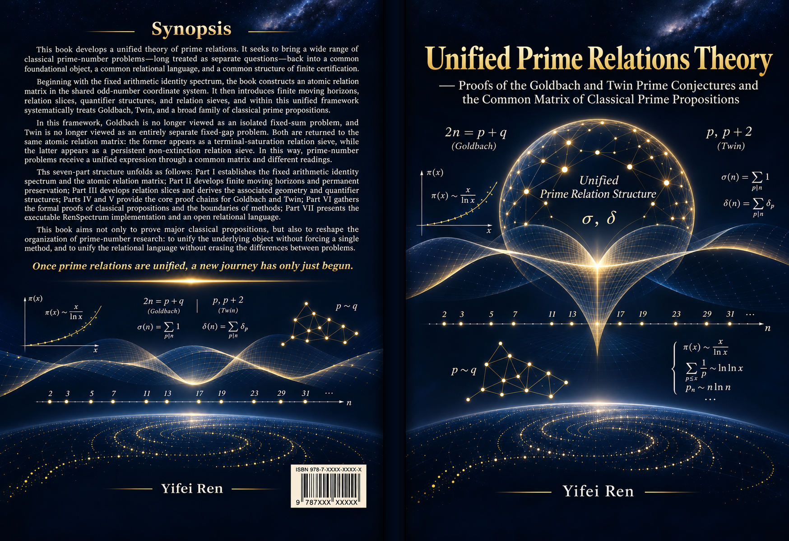

# RenSpectrum · 双书门户

**《统一素数关系理论》** · **《黎曼猜想：证明、谱与它的数学世界》**

中英文介绍 · 关键词 · 全书目录 · A4 排版全书 PDF

[交互教学站 ghtmath.pages.dev](https://ghtmath.pages.dev/) · 作者：任毅飞（独立研究者）

---

## 关于本仓库

本仓库提供两部书稿的**中英文介绍与全书目录**，以及**全书 A4 排版 PDF** 的下载入口。

完整的交互教学站点部署在 Cloudflare Pages：

> **<https://ghtmath.pages.dev>**

站内可逐章阅读正文、查看插图、运行交互课堂；本仓库只存放可下载的文档、封面与目录。原 `qiaoranjushi.github.io/ghtmath` 地址已设为跳转页，会自动前往新站。

---

## 一、统一素数关系理论

**Unified Prime Relations Theory**
——Goldbach、Twin 的证明与经典素数命题的共同母体

### 中文版

| | |
|---|---|
| **介绍 · 关键词 · 全书目录** | [统一素数关系理论.md](<统一素数关系理论.md>) |
| **全书 PDF**（A4 排版，15.1 MB） | [统一素数关系理论_中文版_A4排版.pdf](<prime-relations/books/统一素数关系理论_中文版_A4排版.pdf>) |
| **交互教学** | <https://ghtmath.pages.dev/prime-relations/?lang=zh> |

### English Edition

| | |
|---|---|
| **Introduction · Keywords · Full Contents** | [Unified Prime Relations Theory.md](<Unified Prime Relations Theory.md>) |
| **Full PDF**（A4, 18.3 MB） | [Unified_Prime_Relations_Theory_EN_A4.pdf](<prime-relations/books/Unified_Prime_Relations_Theory_EN_A4.pdf>) |
| **Interactive site** | <https://ghtmath.pages.dev/prime-relations/?lang=en> |

---

## 二、黎曼猜想：证明、谱与它的数学世界

**The Riemann Hypothesis: Proof, Spectra, and the Mathematical World Behind It**
——从乘法身份、广义黎曼猜想到 Hilbert–Pólya 与 GUE

### 中文版

| | |
|---|---|
| **介绍 · 关键词 · 全书目录** | [黎曼猜想：证明、谱与它的数学世界.md](<黎曼猜想：证明、谱与它的数学世界.md>) |
| **全书 PDF**（A4 排版，15.5 MB） | [黎曼猜想_中文版_A4排版.pdf](<riemann-hypothesis/downloads/黎曼猜想_中文版_A4排版.pdf>) |
| **交互教学** | <https://ghtmath.pages.dev/riemann-hypothesis/?lang=zh> |

### English Edition

| | |
|---|---|
| **Introduction · Keywords · Full Contents** | [The Riemann Hypothesis - Proof, Spectra, and the Mathematical World Behind It.md](<The Riemann Hypothesis - Proof, Spectra, and the Mathematical World Behind It.md>) |
| **Full PDF**（A4, 15.0 MB） | [Riemann_Hypothesis_EN_A4.pdf](<riemann-hypothesis/downloads/Riemann_Hypothesis_EN_A4.pdf>) |
| **Interactive site** | <https://ghtmath.pages.dev/riemann-hypothesis/?lang=en> |

---

## 文件说明

| 文件 | 内容 |
|---|---|
| `统一素数关系理论.md` | 中文版介绍、关键词、128 章全书目录 |
| `Unified Prime Relations Theory.md` | English introduction, keywords, full 128-chapter contents |
| `黎曼猜想：证明、谱与它的数学世界.md` | 中文版介绍、关键词、全书目录 |
| `The Riemann Hypothesis - Proof, Spectra, and the Mathematical World Behind It.md` | English introduction, keywords, full contents |
| `封面_*.png` | 四张封面展开图：封底 + 书脊 + 封面 |
| `prime-relations/books/` | 统一素数关系理论 中英文 A4 全书 PDF |
| `riemann-hypothesis/downloads/` | 黎曼猜想 中英文 A4 全书 PDF |
| `index.html` / `404.html` | 旧地址跳转页 |

---

## About

This repository hosts the bilingual introductions, tables of contents, cover spreads, and full A4 PDFs of two books by **Yifei Ren** (independent researcher):

- *Unified Prime Relations Theory* — proofs of the Goldbach and Twin Prime Conjectures and the common matrix of classical prime propositions.
- *The Riemann Hypothesis: Proof, Spectra, and the Mathematical World Behind It* — from multiplicative identity and GRH to Hilbert–Pólya and GUE.

The complete interactive edition — full text, figures, and guided classrooms in both Chinese and English — is published at **<https://ghtmath.pages.dev>**.

---

除另有说明外，本站文本与插图采用 [CC BY-NC 4.0](https://creativecommons.org/licenses/by-nc/4.0/) 许可。

