

# RenSpectrum · 双书门户

**《统一素数关系理论》** · **《黎曼猜想：证明、谱与它背后的数学世界》**

中英文介绍 · 关键词 · 全书目录 · A4 排版全书 PDF

[交互教学站 ghtmath.pages.dev](https://ghtmath.pages.dev/) · 作者：任毅飞（独立研究者）

---

## 目录

- [关于本仓库](#关于本仓库)
- [一、统一素数关系理论](#一统一素数关系理论) — [中文版](#中文版) · [English Edition](#english-edition)
- [二、黎曼猜想：证明、谱与它背后的数学世界](#二黎曼猜想证明谱与它背后的数学世界) — [中文版](#中文版-1) · [English Edition](#english-edition-1)
- [三、数学的地基](#三数学的地基) — GHT 论文 I · 中英文全文 PDF
- [四、证明债务的恢复](#四证明债务的恢复) — Alpöge–Claude 证明的信息层级审计
- [站点截图](#站点截图) — [中文版](#中文版-2) · [English Edition](#english-edition-2)
- [工作台截图](#工作台截图)
- [文件说明](#文件说明)
- [About](#about)

---

## 关于本仓库

本仓库提供两部书稿的**中英文介绍与全书目录**、**全书 A4 排版 PDF**，以及 GHT 数学地基系列论文 I 的**中英文全文 PDF**。

完整的交互教学站点部署在 Cloudflare Pages：

> **<https://ghtmath.pages.dev>**

站内可逐章阅读正文、查看插图、运行交互课堂；本仓库只存放可下载的文档、封面与目录。原 `qiaoranjushi.github.io/ghtmath` 地址已设为跳转页，会自动前往新站。

---

## 一、统一素数关系理论

**Unified Prime Relations Theory**
——Goldbach、Twin 的证明与经典素数命题的共同母体

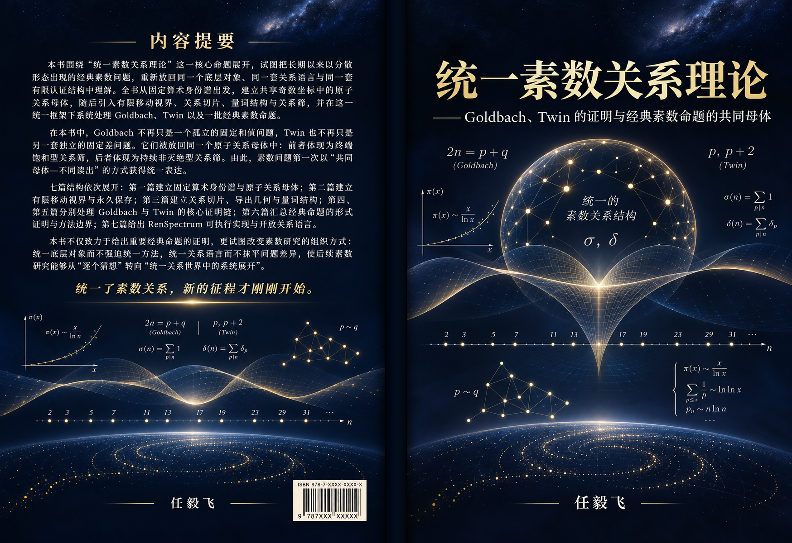

### 中文版

| | |
|---|---|
| **介绍 · 关键词 · 全书目录** | [统一素数关系理论.md](<统一素数关系理论.md>) |
| **全书 PDF**（A4 排版，15.1 MB） | [统一素数关系理论_中文版_A4排版.pdf](<prime-relations/books/统一素数关系理论_中文版_A4排版.pdf>) |
| **交互教学** | <https://ghtmath.pages.dev/prime-relations/?lang=zh> |

### English Edition

| | |
|---|---|
| **Introduction · Keywords · Full Contents** | [Unified Prime Relations Theory.md](<Unified Prime Relations Theory.md>) |
| **Full PDF**（A4, 18.3 MB） | [Unified_Prime_Relations_Theory_EN_A4.pdf](<prime-relations/books/Unified_Prime_Relations_Theory_EN_A4.pdf>) |
| **Interactive site** | <https://ghtmath.pages.dev/prime-relations/?lang=en> |

---

## 二、黎曼猜想：证明、谱与它背后的数学世界

**The Riemann Hypothesis: Proof, Spectra, and the Mathematical World Behind It**
——从乘法身份、广义黎曼猜想到 Hilbert–Pólya 与 GUE

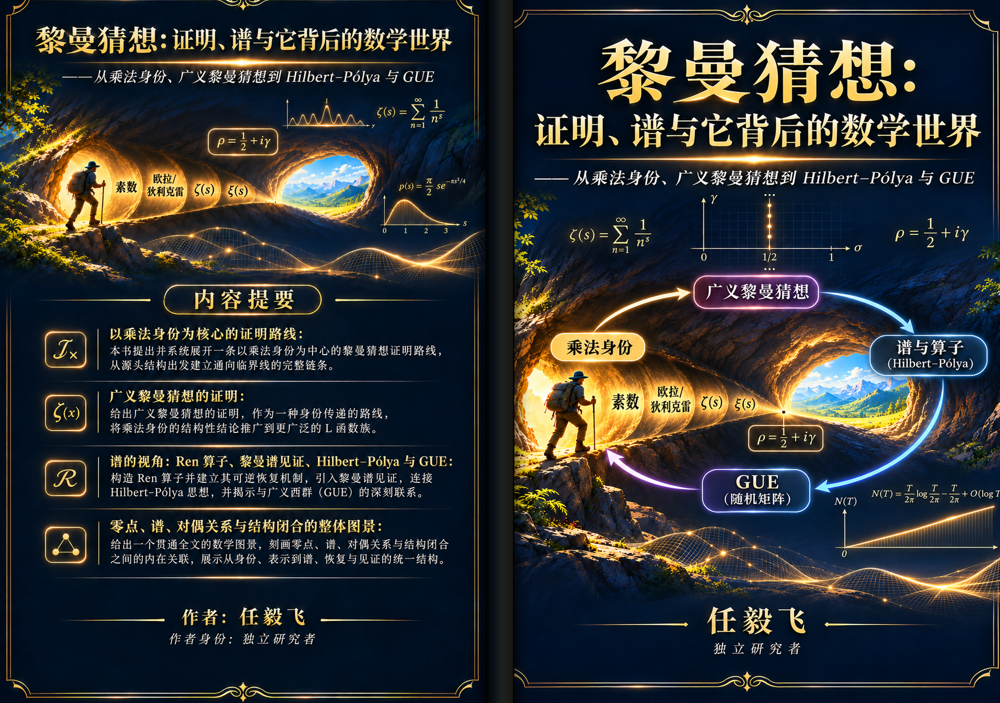

### 中文版

| | |
|---|---|
| **介绍 · 关键词 · 全书目录** | [黎曼猜想：证明、谱与它背后的数学世界.md](<黎曼猜想：证明、谱与它背后的数学世界.md>) |
| **全书 PDF**（A4 排版，12.0 MB） | [黎曼猜想_中文版_A4排版.pdf](<riemann-hypothesis/downloads/黎曼猜想_中文版_A4排版.pdf>) |
| **交互教学** | <https://ghtmath.pages.dev/riemann-hypothesis/?lang=zh> |

### English Edition

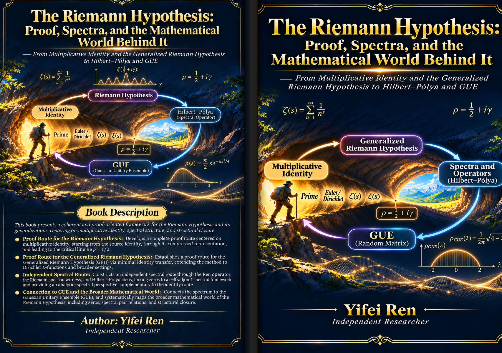

| | |
|---|---|
| **Introduction · Keywords · Full Contents** | [The Riemann Hypothesis - Proof, Spectra, and the Mathematical World Behind It.md](<The Riemann Hypothesis - Proof, Spectra, and the Mathematical World Behind It.md>) |
| **Full PDF**（A4, 11.7 MB） | [Riemann_Hypothesis_EN_A4.pdf](<riemann-hypothesis/downloads/Riemann_Hypothesis_EN_A4.pdf>) |
| **Interactive site** | <https://ghtmath.pages.dev/riemann-hypothesis/?lang=en> |

---

## 三、数学的地基

**《数学的地基：GHT 生成履历理论概论》**

*Foundations of Mathematics: An Introduction to Generative History Theory (GHT)*

> From "This Sentence Has Ended," Traces, and Re-entry to Mathematical Primitives, Arithmetic, and a Common Generative Foundation for Modern Mathematics

**作者**：任毅飞 · 独立研究者 ｜ **发布**：2026-10-26 ｜ **版本**：V1.0 ｜ **DOI**：[10.5281/zenodo.23662772](https://doi.org/10.5281/zenodo.23662772)

GHT 数学地基系列论文 I —— 把数学地基的追问推进到既成数学对象之前。

### 中文摘要

任毅飞的生成履历理论(GHT)把数学地基的追问推进到既成数学对象之前:对象、关系、同一、比较、组合、不变量与尺度如何取得稳定的数学资格。本文以“这句话结束了”为最小边界展示,区分不可数学化的裸发生边界与可表达的第一影层;由可再寻址痕迹、再入与后续指向建立生成履历律 N → N+n 以及生成履历结构 GHS。本文系统提出区别、等价、对象、关系、组合、不变量、尺度七个数学原语,并发展对象—关系一体、Name–Relation 双性、身份—评价单向性、成熟显相、成熟在场、来源连续性、运算类型纪律与 P/H/D 账本。进一步给出自然数、加法、乘法、Prime 以及逻辑、集合论、代数、范畴、拓扑、分析、测度概率、几何、算子与谱论等成熟数学门派的地基接口。本文为 GHT 数学地基系列论文 I,并提供第二篇所调用的最小地基。

### Abstract

Generative History Theory (GHT) moves foundational inquiry one step upstream from already constituted mathematical objects and asks how objects, relations, identity, comparison, composition, invariance, and scale acquire stable mathematical admissibility. The paper uses “This sentence has ended” to distinguish the non-mathematizable boundary of bare occurrence from the expressible first shadow layer. Re-addressable trace and re-entry lead to the Generative History Law N → N+n and to the Generative History Structure (GHS).

On this basis, the paper develops seven mathematical primitives—distinction, equivalence, object, relation, composition, invariant, and scale—together with object–relation unity, Name–Relation duality, the one-way identity-to-evaluation principle, mature manifestation, mature presence, provenance continuity, operation-type discipline, and a Preserved/Hidden/Destroyed (P/H/D) ledger. It then provides foundational interfaces for natural numbers, addition, multiplication, Prime, logic, set theory, algebra, category theory, topology, analysis, measure, probability, geometry, operator theory, and spectral theory. The paper serves as Paper I of the GHT Foundations of Mathematics Series and supplies the minimal foundational interfaces used by Paper II.

### 下载

| | |
|---|---|
| **中文版 PDF**（32 页，3.8 MB） | [01_数学的地基_GHT生成履历理论概论_CN.pdf](<GHT/01_数学的地基_GHT生成履历理论概论_CN.pdf>) |
| **English PDF**（34 页，1.8 MB） | [01_Foundations_of_Mathematics_An_Introduction_to_GHT_EN.pdf](<GHT/01_Foundations_of_Mathematics_An_Introduction_to_GHT_EN.pdf>) |
| **Zenodo 记录** | <https://doi.org/10.5281/zenodo.23662772> |

---

## 四、证明债务的恢复

**《证明债务的恢复 —— Alpöge–Claude 黎曼猜想证明的信息层级审计》**

*The Recovery of Proof Debt — An Information-Layer Audit of the Alpöge–Claude Proof of the Riemann Hypothesis*

**作者**：任毅飞 · 独立研究者 ｜ **发布**：2026-11-23 ｜ **DOI**：[10.5281/zenodo.24458786](https://doi.org/10.5281/zenodo.24458786)
**论文类型**：方法论与证明结构分析 · 25 页

### 中文说明

2026 年 11 月，Levent Alpöge 宣布与 Claude 合作获得黎曼猜想及 Dirichlet L-函数广义黎曼猜想的 Lean 形式化证明：约 17 百万行、175,187 个模块，截至 11 月 23 日已有多项独立构建、内核回放、声明比对与公理审计通过；与此同时，Michael Rubinstein 等正把这一工程还原为人类可读的解析数论证明。

本文不重证该定理，也不评判其技术是否“多余”，而是提出另一种解读：这套极其庞大的证明，可以看作一次**证明债务的恢复过程**。所谓证明债务，是指一个原始结构被压缩为更晚、更可计算的表示之后，原本显式的身份、对偶、正性、尺度或局部—整体关系不再直接可见；要在压缩表示中重新获得这些性质，就必须引入额外的桥梁、估计、辅助对象与兼容性定理。

文章逐层拆解 Alpöge–Claude 路线：从乘法—素数结构压缩到 von Mangoldt 平滑余项后，需要恢复无 floor 的可除性；从局部惰性素数恢复到全部素数，需要角色分解与 character 平均；从可除性恢复到全局上界，需要 lattice size、covolume、迹公式与 Galois 上同调；从函数域中天然的多重接触恢复到整数世界，需要一条长度约 √X 的 theta-lift 链。临界指数 1/2 最终作为两种恢复成本 x/m 与 m 的平衡点重新出现。

文章进一步把这一结构与《黎曼猜想：证明、谱与它背后的数学世界》给出的两条独立路线——H01（互反身份与解析保真）与 H09（Hilbert–Pólya 源生成谱）——作比较，认为三者未必是“不同答案”，更可能位于同一信息链的不同层级。

### English Description

In November 2026, Levent Alpöge announced Lean formal proofs of the Riemann Hypothesis and of the Generalized Riemann Hypothesis for Dirichlet L-functions, obtained in collaboration with Claude: roughly 17 million lines across 175,187 modules, with independent builds, kernel replays, statement comparisons, and axiom audits passing by November 23. Michael Rubinstein and others are now translating that development into a human-readable analytic proof.

This paper does not re-prove the theorem and does not dismiss its machinery as unnecessary. It proposes a reading: the enormous proof can be understood as a **process of recovering proof debt**. Proof debt arises when an original structure is compressed into a later, more computable representation, so that identity, duality, positivity, scale, or local–global relations that were explicit in the source are no longer directly visible; recovering them inside the compressed form requires additional bridges, estimates, auxiliary objects, and compatibility theorems.

The paper reconstructs the Alpöge–Claude route layer by layer: recovering floor-free divisibility after compressing multiplicative/prime structure into a smoothed von Mangoldt remainder; recovering all-prime coverage through character decomposition and averaging; recovering a sharp global size bound through lattice size, covolume, trace formulas, and Galois cohomology; and simulating high-order contact in the integer setting by a theta-lift chain of length about √X. The critical exponent 1/2 then reappears as the balance point between two recovery costs, x/m and m.

It further compares this architecture with the two independent RH routes of *The Riemann Hypothesis: Proof, Spectra, and the Mathematical World Behind It* — H01 (reciprocal identity and analytic fidelity) and H09 (source-generated Hilbert–Pólya spectrum) — arguing that the three are less likely rival answers than different layers of one information chain.

### 下载

| | |
|---|---|
| **中文版 PDF**（25 页，2.36 MB，2026-11-23 更新版） | [证明债务的恢复_Alpoge-Claude_RH证明的信息层级审计_中文版_FINAL_2026-11-23_更新版.pdf](<Proof_Debt_Recovery_Alpoge_Claude_RH/证明债务的恢复_Alpoge-Claude_RH证明的信息层级审计_中文版_FINAL_2026-11-23_更新版.pdf>) |
| **English PDF**（25 页，1.17 MB） | [Proof_Debt_Recovery_Alpoge_Claude_RH_EN_FINAL_2026-11-23.pdf](<Proof_Debt_Recovery_Alpoge_Claude_RH/Proof_Debt_Recovery_Alpoge_Claude_RH_EN_FINAL_2026-11-23.pdf>) |
| **Zenodo 记录** | <https://doi.org/10.5281/zenodo.24458786> |

---

## 站点截图

整页截图，2880 px 宽（2× 像素密度）。中文截图存于 [`screenshots/zh/`](screenshots/zh)，英文截图存于 [`screenshots/en/`](screenshots/en)，点击缩略图查看原图。

### 中文版

<table>
  <tr>
    <td align="center" width="50%"> <b>门户首页</b></td>
    <td align="center" width="50%"></td>
  </tr>
  <tr>
    <td align="center"><a href="screenshots/zh/03_prime-relations.png">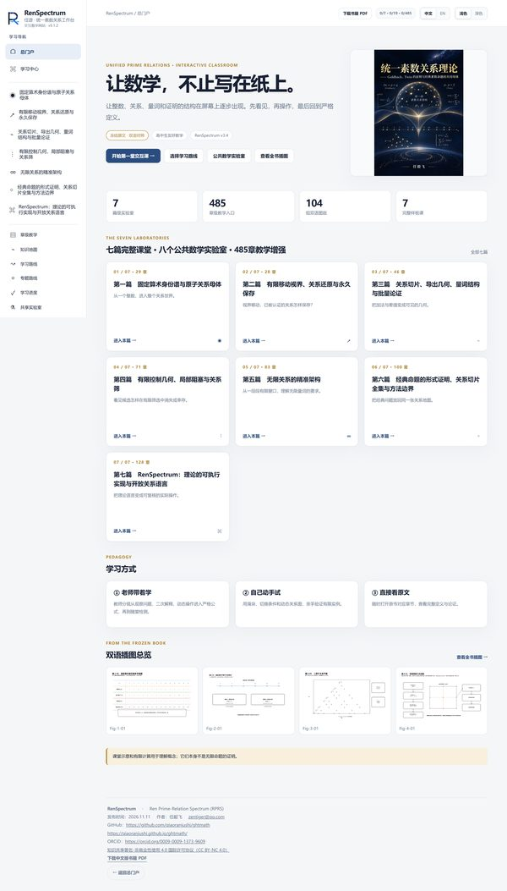</a> 《统一素数关系理论》· 浅色</td>
    <td align="center"><a href="screenshots/zh/07_prime-relations_dark.png">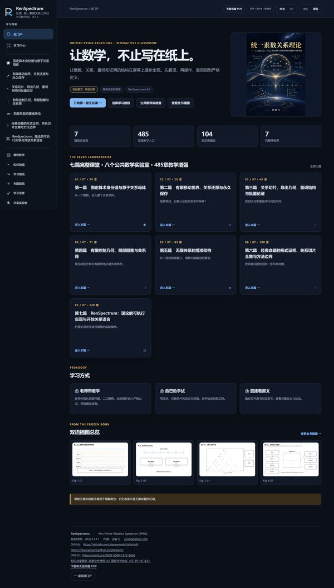</a> 《统一素数关系理论》· 深色</td>
  </tr>
  <tr>
    <td align="center"> 《黎曼猜想》· 浅色</td>
    <td align="center"><a href="screenshots/zh/09_riemann-hypothesis_dark.png">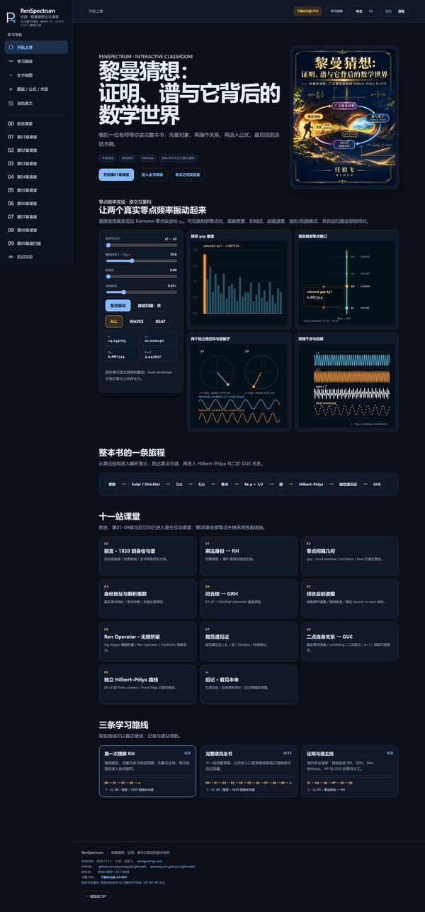</a> 《黎曼猜想》· 深色</td>
  </tr>
</table>

### English Edition

<table>
  <tr>
    <td align="center" width="50%"><a href="screenshots/en/02_portal.png">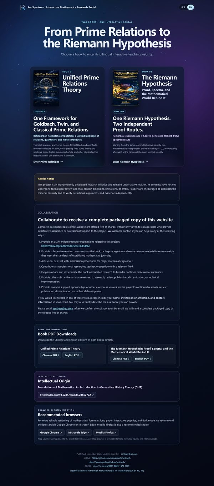</a> <b>Portal Home</b></td>
    <td align="center" width="50%"></td>
  </tr>
  <tr>
    <td align="center"><a href="screenshots/en/04_prime-relations.png">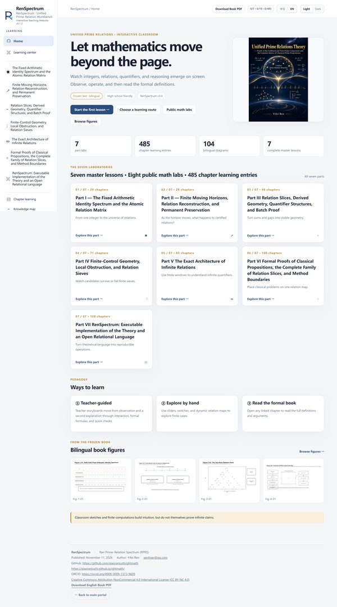</a> <i>Unified Prime Relations Theory</i> · Light</td>
    <td align="center"><a href="screenshots/en/08_prime-relations_dark.png">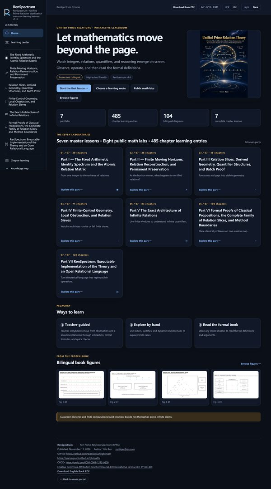</a> <i>Unified Prime Relations Theory</i> · Dark</td>
  </tr>
  <tr>
    <td align="center"><a href="screenshots/en/06_riemann-hypothesis.png">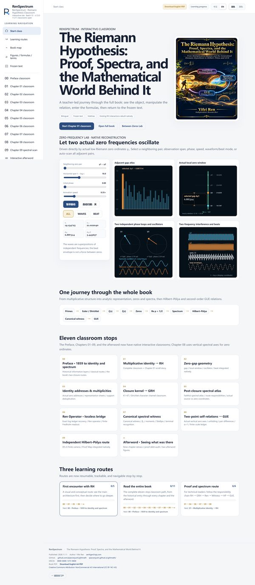</a> <i>The Riemann Hypothesis</i> · Light</td>
    <td align="center"><a href="screenshots/en/10_riemann-hypothesis_dark.png">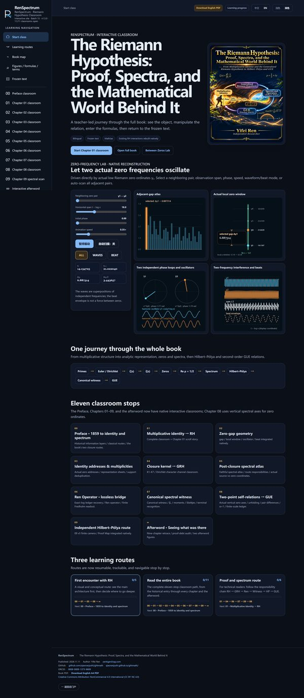</a> <i>The Riemann Hypothesis</i> · Dark</td>
  </tr>
</table>

---

## 文件说明

| 文件 | 内容 |
|---|---|
| `统一素数关系理论.md` | 中文版介绍、关键词、128 章全书目录 |
| `Unified Prime Relations Theory.md` | English introduction, keywords, full 128-chapter contents |
| `黎曼猜想：证明、谱与它背后的数学世界.md` | 中文版介绍、关键词、全书目录 |
| `The Riemann Hypothesis - Proof, Spectra, and the Mathematical World Behind It.md` | English introduction, keywords, full contents |
| `封面_*.png` | 四张封面展开图：封底 + 书脊 + 封面 |
| `GHT/` | 《数学的地基：GHT 生成履历理论概论》中英文全文 PDF（论文 I） |
| `Proof_Debt_Recovery_Alpoge_Claude_RH/` | 《证明债务的恢复》中英文 PDF（各 25 页） |
| `prime-relations/books/` | 统一素数关系理论 中英文 A4 全书 PDF |
| `riemann-hypothesis/downloads/` | 黎曼猜想 中英文 A4 全书 PDF |
| `screenshots/zh/` · `screenshots/en/` | 站点与工作台整页截图，中英文各 6 张（2880 px 宽），各自 `thumbs/` 为 README 缩略图 |
| `index.html` / `404.html` | 旧地址跳转页 |

---

## About

This repository hosts the bilingual introductions, tables of contents, cover spreads, and full A4 PDFs of two books by **Yifei Ren** (independent researcher):

- *Unified Prime Relations Theory* — proofs of the Goldbach and Twin Prime Conjectures and the common matrix of classical prime propositions.
- *The Riemann Hypothesis: Proof, Spectra, and the Mathematical World Behind It* — from multiplicative identity and GRH to Hilbert–Pólya and GUE.

The complete interactive edition — full text, figures, and guided classrooms in both Chinese and English — is published at **<https://ghtmath.pages.dev>**.

---

## 工作台截图

RenSpectrum v3.4 专业工作台完整界面：身份与关系对象、参数与映射表、有限执行记录与 V0–V5 复现信息。整页截图，点击查看原图。

<table>
  <tr>
    <td align="center" width="50%"><a href="screenshots/zh/11_workbench_v3.4.png">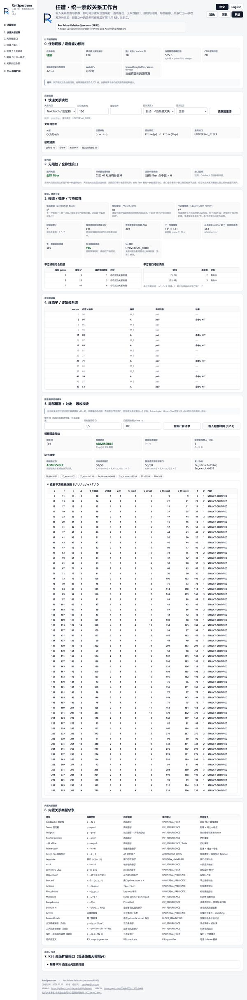</a> <b>RenSpectrum v3.4</b> · 中文</td>
    <td align="center" width="50%"><a href="screenshots/en/11_workbench_v3.4.png">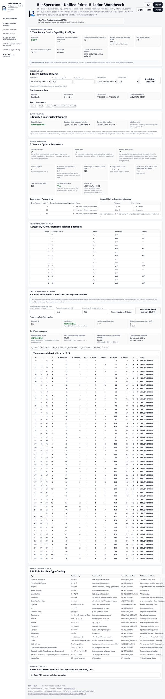</a> <b>RenSpectrum v3.4</b> · English</td>
  </tr>
</table>

---

除另有说明外，本站文本与插图采用 [CC BY-NC 4.0](https://creativecommons.org/licenses/by-nc/4.0/) 许可。

