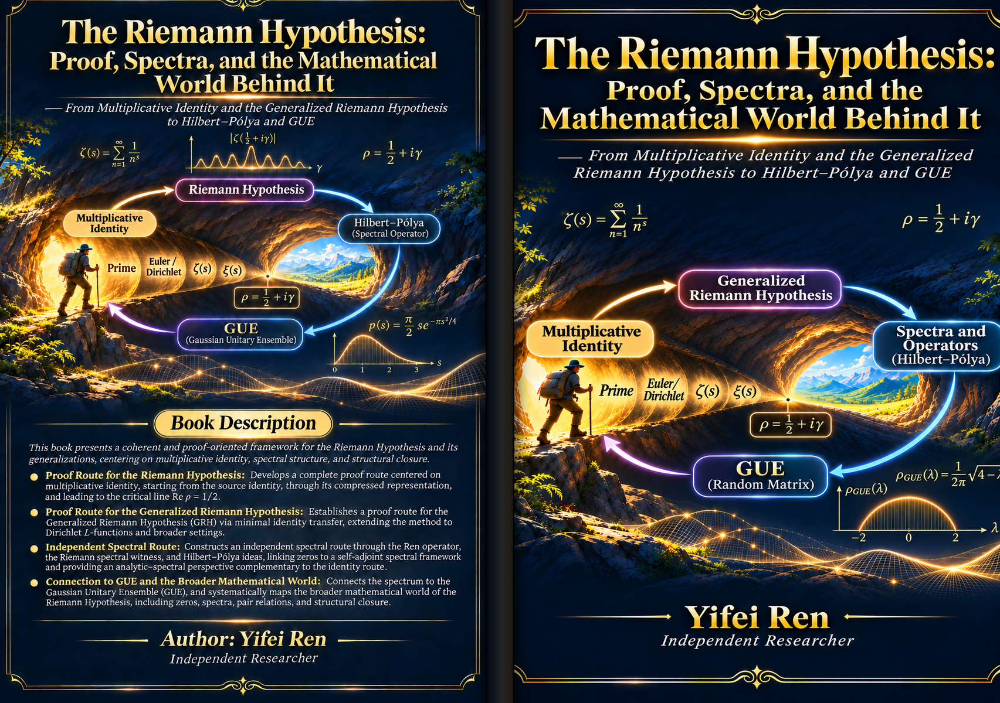

# The Riemann Hypothesis: Proof, Spectra, and the Mathematical World Behind It

> From Multiplicative Identity and the Generalized Riemann Hypothesis to Hilbert–Pólya and GUE

**Author**: Yifei Ren · Independent Researcher

---

## Book Introduction and Synopsis

*The Riemann Hypothesis: Proof, Spectra, and the Mathematical World Behind It* begins with a deceptively simple question: why should the critical real part of every nontrivial zero of the Riemann zeta function be exactly \(1/2\)?

Rather than treating zeros first as isolated analytic coordinates detached from their source, the book starts from the root identity of multiplication in the positive integers and follows how multiplicative relations unfold through the Euler product, Dirichlet encoding, Mellin representation, the completed Riemann function, and the zero spectrum. This leads to a strict stratification of “identity — role — role readout.”

The book presents two mutually independent closure routes for the Riemann Hypothesis.

The first begins with open multiplicative relations, reciprocal roles, moving horizons, and complete event histories. It faithfully transmits the reciprocal fixed role of the generative source to the terminal zero representation, yielding \(\Re\rho=1/2\).

The second starts again, independently, from the root multiplicative identity. Through scanning functionals, dual Hankel/Gram positivity, Stieltjes reconstruction, and the spectral theorem, it generates a Hilbert–Pólya self-adjoint spectrum and then recovers the Riemann zeros. Only after the two proof chains have independently completed their own closures do they meet at the identity of the canonical Riemann spectrum.

Between these two main proofs, the book further studies the local-to-global geometry of zero gaps, the separation of zero addresses from analytic multiplicities, the Dirichlet Generalized Riemann Hypothesis, the canonical Riemann spectral operator, a unique spectral witness, and the mathematical interface from the first-order Riemann spectrum to Montgomery–GUE second-order statistics.

This is therefore not a book concerned only with whether the zeros lie on the critical line.

It seeks to reorganize

\[
\boxed{
\text{multiplicative identity}
\to
\text{analytic object}
\to
\text{zeros}
\to
\text{self-adjoint spectrum}
\to
\text{second-order statistics}
}
\]

into a continuous mathematical chain that can be traced, recovered, and independently verified.

## Keywords

**Core Keywords:**

Riemann Hypothesis; Riemann zeta function; critical line; multiplicative identity of the positive integers; open multiplicative relations; identity fidelity; reciprocal roles; moving horizon; centered Mellin representation; completed Riemann function; terminal closure; Dirichlet Generalized Riemann Hypothesis; Hilbert–Pólya; self-adjoint operator; Ren Operator; Riemann spectrum; spectral witness; Stieltjes moment problem; Hankel positivity; Gram positivity; zero gaps; Herglotz response; analytic multiplicity; GUE; Montgomery pair correlation; explicit formula; random matrices; spectral theory

**Promotional Keywords:**

**One Riemann Hypothesis, two independent proof routes; why \(1/2\); reciprocal-event closure; independent Hilbert–Pólya spectral generation; from multiplication to zeros; from zeros to spectrum; from first-order spectrum to GUE.**

## Full Table of Contents

- Front Matter and Author’s Note
- **Preface — From the Question of 1859 to a Double Closure of Identity and Spectrum**
  - 1. Why Has a Conjecture of One Sentence Lasted for More Than a Century and a Half?
  - 2. From Euler to Riemann: Primes Enter the Complex Domain
  - 3. 1896: Riemann's Method First Proves the Prime Number Theorem and Leaves the Deeper Question Open
  - 4. From Hardy to Conrey: The Critical Line Is Not an Empty Formal Center
  - 5. Computation, Equivalent Criteria, and Positivity Routes: New Pictures of the Same Problem
  - 6. Hilbert–Pólya: If the Zeros Form a Self-Adjoint Spectrum, \(1/2\) Appears in a Different Way
  - 7. Montgomery, Dyson, and Odlyzko: The Zeros Resemble Not Only a Spectrum, but the Spectrum of Quantum Chaos
  - 8. What Actually Led to This Book Was Not “Another Route,” but a Reorganization of Identity
  - 9. The Two Closure Routes for the Riemann Hypothesis Presented in This Book
  - 10. Chapter 1: Open Multiplicative Relations and Reciprocal Zero-Event Closure
  - 11. Chapter 2: After Zero Closure, How Can One Gap Carry the Whole Spectrum?
  - 12. Chapter 3: Addresses, Representation Sheets, and Analytic Multiplicity Must Be Kept Separate
  - 13. Chapter 4: Parameterizing the Riemann Closure Kernel and Proving the Generalized Riemann Hypothesis
  - 14. Chapter 5: After the Riemann Hypothesis Is Closed, Horizontal Position and Vertical Frequency Separate Again
  - 15. Chapter 6: The Ren Operator and Bidirectional Recovery Between Multiplication, Analysis, and Spectrum
  - 16. Chapter 7: How a Scalar Witness Uniquely Recognizes the Riemann Spectrum
  - 17. Chapter 8: From the First-Order Riemann Spectrum to GUE Two-Point Self-Relations
  - 18. Chapter 9: Independently Generating a Hilbert–Pólya Self-Adjoint Spectrum from the Root Multiplicative Identity
  - 19. How to Read This Book
  - 20. On the Word “Proof”: Strength and Humility Must Coexist
  - 21. Before the Main Text: Curiosity Is Still the Real Beginning of This Book
- **Chapter 1 — Open Multiplicative Relations, Analytic Identity Fidelity, and Reciprocal Zero-Event Closure of the Riemann Hypothesis**
  - Abstract
  - Overview: One Multiplicative Identity, Many Representations
  - 0.1 Root Identity: Multiplication of the Positive Integers Itself
  - 1. Introduction
  - 2. Open Multiplicative Relations and the Unique Self-Dual Fixed Readout
  - 3. Centered Mellin Representation
  - 4. Global Dirichlet Encoding and the Moving Horizon
  - 5. Reciprocal Zero-Events and Terminal Readouts
  - 6. The Open-Multiplication Event Law, Exact Transmission, and Terminal Closure
  - 7. Main Theorem
  - 8. Reciprocal Role Readouts Inside an Event Do Not Mean That Actual Zeros Move Off the Critical Line
  - 9. Conclusion
  - Appendix A. Reciprocal Boundary Geometry of Finite Horizons
- **Chapter 2 — Horizon-Shape Geometry of Riemann Zero Gaps**
  - — Boundary Analytic Germs, Global Spectral Determination, and Finite-Jet Gap Bounds
  - Reader's Guide: From One Gap to the Entire Real Zero Spectrum
  - Abstract
  - 0. Logical Position, Prior Input, and Object Boundaries
  - 1. The Real Zero Spectrum and Basic Setup
  - 2. Meromorphic Herglotz Response and Phase Monotonicity
  - 3. Canonical Horizon-Shape Density
  - 4. Interval Reconstruction and Quantization of Boundary Multiplicity
  - 5. Reciprocal Boundary Coordinate and All-Order Boundary-Jet Gluing
  - 6. The Boundary Analytic Germ Generates Global Inverse-Distance Spectral Moments
  - 7. Global Spectral Determination from a One-Sided Boundary Analytic Germ
  - 8. Relation to Herglotz Inverse-Spectral Representation
  - 9. Nearest-Neighbor Gap Bounds from Finite Jets
  - 10. Residual-Moment Trichotomy for Adjacent Gaps
  - 11. Hankel Positivity of Boundary Spectral Moments
  - 12. Global Exterior Spectral Field and the Phase Center
  - 13. Classical Foundations and the Unified Structure
  - 14. Conclusion
  - Appendix A: The First Three Boundary Spectral Coefficients
- **Chapter 3 — Identity Addresses and Analytic Multiplicities of Riemann Zeros**
  - 1. Position of This Chapter and Object Levels
  - 2. The Centered Parameter and Terminal Zero Addresses
  - 3. Zero Support, Zero Addresses, and the Analytic Divisor
  - 4. Strict Stratification of the Three Counts
  - 5. Reciprocal Representation and Address Fidelity
  - 6. Complete Intervals and Endpoint Addresses
  - 7. Shared Boundaries of Adjacent Intervals and Deduplication
  - 8. From Local Addresses to Global Support
  - 9. Support Counting and Divisor Counting
  - 10. The Argument Principle and Finite-Height Multiplicity Checks
  - 11. Interface with the Zero-Gap Geometry of Chapter 2
  - 12. Interface with the Spectral Objects of Chapters 5–9
  - 13. Main Theorem: Stratification of Address, Sheet Count, and Analytic Multiplicity
  - 14. Conclusion
- **Chapter 4 — Parameterization of the Riemann Closure Kernel and Proof of the Generalized Riemann Hypothesis**
  - 1. Parameterized Objects and Logical Position
  - 2. Root Reciprocal System
  - 3. Centered Reciprocal Representation
  - 4. Two-Channel Analytic Encoding
  - 5. Multiple Representations of the Same Event
  - 6. Exact Transmission of the Centered Parameter
  - 7. Reciprocal-Role Fidelity
  - 8. Complete Events and Generative-Source Fixed Roles
  - 9. Terminal Analytic Reciprocal Involution
  - 10. Terminal Role Readouts
  - 11. Core Theorem: Terminal Fixed-Role Readout
  - 12. Zero Fidelity and Terminal Exhaustivity
  - 13. The Minimal Seven-Condition Closure Kernel
  - 14. The Riemann Realization
  - 15. Coordinate-Type Discipline
  - 16. Interface with Chapter 3: Zero Addresses and Analytic Multiplicities
  - 17. Interface with the Zero-Gap Geometry of Chapter 2
  - 18. Generalization Theorem and Conditions of Applicability
  - 19. The Minimal Migration Problem for Dirichlet–GRH
  - 20. Character-Weighted Centered Dirichlet Representation
  - 21. Primitive-Character Completion and Terminal Reciprocity within the Same Channel
  - 22. Primitive Dirichlet–GRH
  - 23. Imprimitive Characters and Finite Euler Factors
  - 24. Principal Characters and the Riemann Channel
  - 25. Main Dirichlet–GRH Theorem and the Meaning of “One Identity”
  - 26. Minimizing the Logical Dependencies
  - 27. Conclusion
- **Chapter 5 — A Faithful Event Spectral Atlas after Closure of the Riemann Hypothesis**
  - 0. Logical Position of This Chapter: the Post-Closure Spectral-Atlas Layer
  - 1. Zero Coordinates Fixed by RH Closure
  - 2. Closed Spectrum and Event Lifts
  - 3. Definition of a Faithful Event Spectrum
  - 4. Minimal Local Event Carrier
  - 5. Representation-Sheet Multiplicity versus Analytic Zero Multiplicity
  - 6. Actual Closed Spectrum and Event-Lift Spectrum
  - 7. Multiplicative Generative-Source Coordinates: \(L_\times\) and \(R\)
  - 8. Two Orthogonal Directions of a Zero: \(d_\rho\) and \(\gamma_\rho\)
  - 9. Prime-Power Generative Spectrum and Zero Frequencies
  - 10. The Faithful Post-Closure Spectral Atlas
  - 11. Hilbert–Pólya: Realization of the Vertical Spectrum
  - 12. Berry–Keating: Scale Generator and the Vertical Spectrum
  - 13. Random Matrices: Two-Point and Higher-Order Relations of the Vertical Spectrum
  - 14. Weil Positivity: Global Arithmetic–Spectral Response
  - 15. de Branges and \(\Theta_\omega\): Horizontal Scanning
  - 16. Connes Scaling / Spectral Triples: Finite Generative Sources and the Vertical Spectrum
  - 17. Suzuki's Finite Weil Spectral Convergence: Spectral Convergence from Finite to Global
  - 18. Carathéodory–Fejér / Real-Zero Mechanisms: Finite All-Real Spectra
  - 19. Geometric and Cohomological Routes: the Geometric Origin of the Fixed Axis
  - 20. Five Logical Non-Equivalences among Spectral Routes
  - 21. Structural Interpretation of the Faithful Spectral Atlas
  - 22. Fidelity Conditions for Spectral Representations
  - 23. Stratification of Spectral Routes after Closure
  - 24. Logical Boundaries of the Spectral-Atlas Layer
  - 25. Conclusion
- **Chapter 6 — The Ren Operator: A Lossless Bridge between Multiplicative Identity, Analytic Continuation, and the Canonical Spectrum**
  - 1. Operator Position, Object Levels, and Naming
  - 2. Multiplicative Identity, the Dirichlet Region, and Analytic Continuation
  - 3. The Centered Completed Riemann Function and the Ren Operator
  - 4. Fredholm Determinants and Resolvent Recovery
  - 5. The Fully Marked Ren–Riemann Object and Reverse Recovery
  - 6. Forward Generation, Reverse Recovery, and the Lossless Bridge
  - 7. RH Specialization, Bare-Spectral Readout, and Interfaces with the Rest of the Book
  - 8. Operator Readouts and Immediate Consequences
  - 9. Structural Summary and Conclusion
  - Appendix A | Core Notation
  - Appendix B | Dependency Diagram
  - Appendix C | Relation to the Independent Hilbert–Pólya Route of Chapter 9
  - Appendix D | Terminology and Object Levels
- **Chapter 7 — Riemann Spectral Witness Theorem: Uniqueness of the Ren Canonical Spectral Witness and Hilbert–Pólya Identity Transfer**
  - 1. The Generative Layer and the Witness Layer
  - 2. Extracting a Canonical Spectral Witness from the Full Ren–Riemann Object
  - 3. The Canonical Riemann Spectral Witness
  - 4. Scalar Complete Spectral Witness Theorem
  - 5. Local Analytic Germs and Full Moment Witnesses
  - 6. Uniqueness from the Response on an Open Interval
  - 7. Cyclic Spectral Realization of the Witness
  - 8. Cyclic Witness Uniqueness Theorem
  - 9. From the Bounded Witness Operator to a Hilbert–Pólya Operator
  - 10. Recovering Analytic Multiplicities and Divisor Amplification
  - 11. Identification Theorem from a Source-Generated Spectrum to the Riemann Spectrum
  - 12. Relation to the Independent Hilbert–Pólya Route of Chapter 9
  - 13. Object-Level Identification versus Pointwise Indexing
  - 14. Identity-Faithful and Divisor-Faithful Representations
  - 15. Bidirectional Reconstruction Between Identity and Divisor Representations
  - 16. Canonical Classification of Hilbert–Pólya Realizations
  - 17. Fredholm Compatibility
  - 18. Information Hierarchy
  - 19. Object Levels in Hilbert–Pólya-Related Spectral Routes
  - 20. Interface with the Second-Order Spectral Statistics of Chapter 8
  - 21. Finite-Dimensional Truncation and Moment Consistency
  - 22. Formal Extension to General Completed \(L\)-Functions
  - 23. Riemann Spectral Witness and Transfer Theorem
  - 24. Conclusion
  - Appendix A | Core Notation
  - Appendix B | Equivalent Entrances to the Witness Condition
  - Appendix C | Object Scope of the Witness Theorem
- **Chapter 8 — From the Riemann Spectral Witness to GUE**
  - 1. From First-Order Spectral Identity to Second-Order Self-Relations
  - 2. Montgomery–Dyson–Odlyzko Background for Two-Point Statistics
  - 3. From a Deterministic First-Order Spectrum to an Exact Two-Point Trace
  - 4. Unfolding: Removing the Mean Density
  - 5. Second-Order Correspondence between the \(\zeta\)-Spectrum and GUE
  - 6. Arithmetic Interface from the First-Order Spectrum to the Prime Side
  - 7. The Two-Point Self-Product and \(\Lambda(m)\Lambda(n)\)
  - 8. The Diagonal Term and the Montgomery Ramp
  - 9. Off-Diagonal Terms: Multiplicative Locality and Additive Near-Diagonality
  - 10. \(\alpha=1\): The Second-Order Multiplicative-Source Resolution Threshold
  - 11. Arithmetic Form of the Plateau and the Connected Second-Order Term
  - 12. The Goldston–Montgomery Bridge and Prime Variance in Short Intervals
  - 13. Non-Equivalence of First-Order Self-Adjoint Structure and the GUE Second-Order Law
  - 14. Non-Equivalence of Low-Order Means and the Second-Order Plateau
  - 15. Functional Equation and the Dual Diagonal Main Term
  - 16. Arithmetic Strengthening for the Classical Infinite-GUE Asymptotic: Actual-to-Dual Diagonal Transfer
  - 17. The Ratios Method and Higher-Order Arithmetic Coordinates for the Classical GUE Asymptotic
  - 18. The Two-Sided \(\zeta\)–GUE Migration Interface
  - 19. Renormalized Migration Coordinates and Finite-Scale Residuals
  - 20. Fit-Free Migration: Independent Subtraction of Local \(\zeta\)-Structure
  - 21. Window Stability of the High-Scale Residual
  - 22. Eight Components of the Finite-Scale Difference
  - 23. A Posteriori Constant Fitting versus Independently Defined Corrections
  - 24. Finite-Height Calibration: Finite \(\zeta\) versus Finite CUE
  - 25. Distinguishing Two Kinds of Finite-Scale Residual
  - 26. Finite-to-Finite Renormalization Interface and the Universal Quotient Space
  - 27. Renormalization Handshake Theorem: Structural Interface and Asymptotic Specialization
  - 28. Source-Generated Equivalent GUE Interface: First-Order Witness Inheritance to Second-Order Statistics
  - 29. The Renormalized Residual as a Second-Order Data Coordinate
  - 30. Correction Rules after Renormalizing the Raw Data
  - 31. Arithmetic–Unitary-Matrix Correspondence in Function Fields
  - 32. Six Logical Non-Equivalences
  - 33. The Three Responsibilities of RH, HP, and GUE
  - 34. Precise Meaning of the Renormalization Interface
  - 35. Unified Structure of First-Order Spectra and Second-Order Statistics
  - 36. Formal Extensions and Higher-Order Interfaces
  - 37. Conclusion: From First-Order Spectral Identity to Second-Order Self-Relations
  - Appendix A | Levels of Conclusions and Types of Evidence
  - Appendix B | Master Diagram of the \(\zeta\)–GUE Hierarchy
  - Appendix C | Raw-to-Renormalized Correction Ledger
  - Appendix D | From First-Order Multiplicative Readout to the Second-Order Interface: Structural Chain and Numerical Checks
  - Appendix E | Riemann Zeros and the Language of Quantum Spectra: From Montgomery–Dyson to Second-Order Spectral Statistics
- **Chapter 9 — Another Closure Path for the Riemann Hypothesis: Open Multiplicative Identity and an Independent Hilbert–Pólya Spectral Route**
  - Abstract
  - 0.1 Object Position of the Hilbert–Pólya Route
  - 1. Proof Structure and Object Levels
  - 2. Root Multiplicative Identity, Open Relation, and Role Exchange
  - 3. The Multiplicative-Source Hamiltonian and the Completed Riemann Function
  - 4. Unified Single-Identity Closure Package
  - 5. Two-Depth Identity Self-Pairing and Dual Gram Positivity
  - 6. Finite Source–Krylov Spectral Truncations
  - 7. Independence of the Generative Inputs
  - 8. Finite Source-Side Truncation and Independent Zero Comparison
  - 9. Gaussian Quadrature: Identity and Weight Readout of the Finite Spectral Truncation
  - 10. Dual Gram Positivity and Stieltjes Reconstruction
  - 11. The Global Hilbert Space
  - 12. Krylov Spaces: Standard Operator Form of the Finite Scan
  - 13. Recovery of the Complete Infinite Spectrum from Finite Spectral Truncations
  - 14. Meromorphicity and the Discrete Atomic Spectrum
  - 15. Recovery of the Zeros
  - 16. Recovery of Analytic Multiplicities
  - 17. The Global Hilbert–Pólya Operator
  - 18. Divisor-Faithful Amplification
  - 19. Fredholm Determinant
  - 20. Canonical Spectral Witness: Identity-Level Identification and Divisor Amplification
  - 21. Terminal Identification between the Source-Generated Spectrum and the Canonical Riemann Spectrum
  - 22. Main Proof Chain: Independent Hilbert–Pólya \\(\\Rightarrow\\) RH
  - 23. Structural Compression after Identity Preservation
  - 24. Interface with the Second-Order Spectral Relations of Chapter 8
  - 25. Theorem Dependencies and Object Levels
  - 26. Generative Independence and Terminal Identification
  - 27. Main Theorem System
  - 28. Closure Structure of the Independent Hilbert–Pólya Route
  - 29. Conclusion: Source-Generated Spectral Closure of the Root Multiplicative Identity
  - Appendix A | Core Notation and Object Levels
  - Appendix B | Generative Independence and Object Boundaries
- **Afterword**
  - Part I — Seeing What Was There All Along: How a Problem Is Made, and How It Becomes Visible Again
    - 1. In the End, We Return to the Smallest Question
    - 2. It All Began with Curiosity, Not Ambition
    - 3. Objectification Is One of Mathematics' Greatest Powers—and It Can Also Leave Proof Debt
    - 4. I Repeatedly Saw “the Final Step”—Then Began Asking Whether It Was Always the Same Step
    - 5. Minimal Sufficient Retreat: Not Returning Mathematics to Nothingness, but Retreating Until the Problem Becomes Visible Again
    - 6. The Last Century and a Half Was Not a Detour, but an Enormous Repository of Mathematical Tools
  - Part II — When Identity Reappears: How Proof Moves from Explanation into Mathematics
    - 7. Identity Clarification Did Not Stop at Explanation; It Entered the First Proof
    - 8. The Meaning of the Spectral Route Also Changed: from a Possible Explanation to a Second Independent Proof
    - 9. GUE Then Returns to Its Proper Place
  - Part III — After Proof: Public Verification, History, and Mathematics That Continues to Grow
    - 10. “We Have Proved the Riemann Hypothesis” and “The Mathematical Community Has Accepted the Proof” Are Two Different Sentences
    - 11. The Best Ending for a Book Is Not to Ask for Belief, but to Begin Being Seriously Tested
    - 12. Mathematics Continues after the Proof
    - 13. Thanking the Past Is Not Courtesy; It Is Respect for Mathematical Fact
    - 14. I Increasingly Believe That Curiosity Is More Worth Protecting Than the Desire to “Solve a Great Problem”
    - 15. Private Curiosity and Public Mathematics
- **Acknowledgements**
  - To My Parents and Family
  - To My Friends at Matrix
  - To the People I Have Met Along the Way
  - To Those Who Never Asked Me to Become Someone Else
  - Finally, to You, the Reader
- **References**
  - I. Historical Foundations of the Riemann Zeta Function, the Prime Number Theorem, and the Riemann Hypothesis
  - II. Equivalent Criteria, Positivity, Function Spaces, and Moment Problems
  - III. Hilbert–Pólya, Operator Theory, and Spectral Routes to the Riemann Problem
  - IV. Montgomery–GUE, Random Matrices, and Second-Order Spectral Statistics
  - V. Harmonic Analysis, Probabilistic Structures, and Basic Tools
  - VI. Work by the Author
  - VII. Current Status and Historical Sources

---

### Links

- Interactive site: <https://ghtmath.pages.dev/riemann-hypothesis/>
- Full PDF: <riemann-hypothesis/downloads/Riemann_Hypothesis_EN_A4.pdf>
- 中文版: <黎曼猜想：证明、谱与它的数学世界.md>
- Back to repository: <https://github.com/qiaoranjushi/ghtmath>
