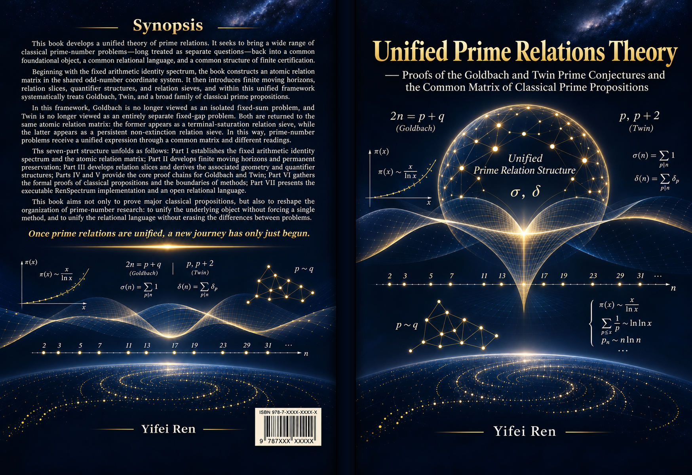

# Unified Prime Relations Theory

> Proofs of the Goldbach and Twin Prime Conjectures and the Common Matrix of Classical Prime Propositions

**Author**: Yifei Ren · Independent Researcher

---

## Book Introduction and Synopsis

*Unified Prime Relations Theory* seeks to change the long-standing way prime-number problems have been organized as “one conjecture, one language.” Starting from the fixed arithmetic identities of integers, the book develops a framework of atomic generation, relation birth, finite moving horizons, relation fidelity, sum–difference coordinates, relation slicing, quantifier classification, and finite certificates, thereby placing historically separate prime problems back into a common relational matrix.

Within this framework, Goldbach’s conjecture and the Twin Prime Conjecture are no longer treated as two completely isolated problems. Goldbach’s conjecture is identified as a fixed-sum universal fiber in the same two-atom relation field, and the book closes its universal statement through a “terminal-saturation relation sieve.” The Twin Prime Conjecture is identified instead as an infinite-recurrence problem on a fixed unit-difference relation; through consecutive square moving horizons, relation supply, finite absorption, and cross-horizon accumulation, it is organized as a “persistent non-extinction relation sieve.”

The book further compiles prime tuples, the Green–Tao theorem, window-type problems, polynomial orbits, prime gaps, complete prime-factor relations, and a range of classical number-theoretic propositions into the unified standard form “relation orbit — identity condition — observation region — global quantifier.”

Unification does not mean erasing genuine differences. The book insists on “unifying the object layer without forcing concrete tools into a single method”: the circle method, sieve methods, analytic methods, finite primality certificates, and other tools retain their own information levels.

Across seven parts and 485 chapters, the theory ultimately reaches a formal relation language and an executable verification layer through the RenSpectrum workbench.

What the book seeks to establish is not merely proofs of two classical conjectures, but a unified theory of prime relations devoted to the study of **relation types and their certificates**.

## Keywords

**Core Keywords:**

Unified Prime Relations Theory; fixed arithmetic identity spectrum; prime atoms; atomic relation matrix; relation birth; finite moving horizon; relation fidelity; permanent relations; sum–difference coordinates; relation slicing; relational quantifiers; finite certificates; Goldbach’s conjecture; Twin Prime Conjecture; terminal saturation; persistent non-extinction; CRT survival tree; true death; relation sieve; prime tuples; Green–Tao; classical prime problems; formal proof; RenSpectrum; RPRS; relation compilation; executable verification

**Promotional Keywords:**

**One framework for a family of problems; batch proof rather than batch computation; a unified language of relations; Goldbach’s conjecture; Twin Prime Conjecture; finite certification of infinite claims; from mathematical theory to executable verification.**

**Highly Recommended Interactive Classroom:** [https://qiaoranjushi.github.io/ghtmath/](https://qiaoranjushi.github.io/ghtmath/)

**Author: Yifei Ren | Independent Researcher**

## Full Table of Contents

- Author’s Note
- Preface: From Isolated Prime Mysteries to a Unified World of Relations
- Terminology Glossary — Unified Prime Relations Theory
- **Part I — The Fixed Arithmetic Identity Spectrum and the Atomic Relation Matrix**
  - Chapter 1 — The First Object: The Fixed Arithmetic Identity Spectrum
  - Chapter 2 — Identity and Relation: Two Levels That Cannot Be Interchanged
  - Chapter 3 — Why Atomic Coordinates Are Still Needed
  - Chapter 4 — Two Basic Operations on the Shared Coordinates
  - Chapter 5 — Multiplicative Compression: Exact Transport of Odd Multiplication
  - Chapter 6 — Additive Expansion: Expressing Two-Odd-Integer Relations in the Same Coordinates
  - Chapter 7 — Irreducible Atoms: Odd Primes Emerge from Multiplication Itself
  - Chapter 8 — Unique Atomic Factorization and Multiplicative History
  - Chapter 9 — Atomic Rays: Linearization of Multiplicative Generation
  - Chapter 10 — Coverage of Non-Atoms and Recursive Generation of the Next Atom
  - Chapter 11 — From Atomic Points to Relational Objects
  - Chapter 12 — The Law of Relation Birth: One New Atom Produces an Entire Row
  - Chapter 13 — Ray–Relation Duality: Two Expansions Triggered by the Same Atom
  - Chapter 14 — Combinatorial Amplification and Block Seams
  - Chapter 15 — Persistent Embedding: Why Historical Relations Are Never Lost
  - Chapter 16 — Translation of Relation Rows: History Is Not Random Resampling
  - Chapter 17 — Lossless Sum–Difference Coordinates
  - Chapter 18 — From “Relation Instances” to “Relation Slices”
  - Chapter 19 — From Two-Atom Slices to General Position Maps
  - Chapter 20 — Windows, Consecutive Primes, and Complete Factor Identity Are Also Slices
  - Chapter 21 — Unified Relation Normal Form
  - Chapter 22 — Relation Fidelity: Why One Cannot Compress Too Early to a Single Number
  - Chapter 23 — The Natural Entry Point to Higher-Order Relations
  - Chapter 24 — Formal Definition of the Finite-Layer Matrix
  - Chapter 25 — Zeroth-Order Closure of Matrix Dynamics
  - Chapter 26 — A Complete Small Example
  - Chapter 27 — Summary Table of Foundational Theorems in Part I
  - Chapter 28 — From Relation Slices to Quantifier Structures
  - Chapter 29 — How to Read the Relation Matrix
- **Part II — Finite Moving Horizons, Relation Reconstruction, and Permanent Preservation**
  - Chapter 1 — Why Fixed Identity Cannot Replace Relation
  - Chapter 2 — Relation Reconstruction: What It Means to Truly Preserve a Relation
  - Chapter 3 — Persistent Relation Filtering: Why Old Relations Are Never Lost
  - Chapter 4 — Candidate Relations and Confirmed Relations
  - Chapter 5 — Relation-Faithful States: Why One Count Is Usually Not Enough
  - Chapter 6 — Unified Moving Horizons: How a Finite Window Receives Zero-Error Atomic Certification
  - Chapter 7 — Prime Squares: The Natural Discrete Boundaries of Moving Horizons
  - Chapter 8 — Genuine Death Layers: A Composite Dies for the First Time Only Once
  - Chapter 9 — Relation-Faithful Sieves: From Endpoint Death to Relation Death
  - Chapter 10 — Terminal Certification of Finite Relations
  - Chapter 11 — Promotion from Candidate Shells to the Permanent Relation Skeleton
  - Chapter 12 — Relation Histories: An Object Has Not Only a Result but a Generative History
  - Chapter 13 — Birth and Death Are Strictly Misaligned in Scale
  - Chapter 14 — A Moving Horizon Does Not Create Relations; It Reads Them Terminally
  - Chapter 15 — Unified Horizons and Readout-Adapted Horizons
  - Chapter 16 — Unified Normal Form for Relation Reconstruction
  - Chapter 17 — How Finite Horizons Enter Infinite Quantifiers
  - Chapter 18 — Finite-to-Infinite Entry Theorem
  - Chapter 19 — How Different Global Quantifiers Enter the Same Matrix
  - Chapter 20 — The Finite Foundation of Batch Proof
  - Chapter 21 — Four Basic Forms of Finite Closure
  - Chapter 22 — Four Basic Examples
  - Chapter 23 — Unified Dynamics: Birth, Elimination, Promotion, Persistence, and Readout
  - Chapter 24 — Summary Table of Foundational Theorems in This Part
  - Chapter 25 — The Relation Layer Cannot Be Erased by the Fixed Spectrum
  - Chapter 26 — Discipline Between Finite Layers and Global Propositions
  - Chapter 27 — General Technical Interface for Relation-Faithful Sieves
  - Chapter 28 — From Finite Terminality to Unified Prime Relations Theory
- **Part III  Relation Slices, Derived Geometry, Quantifier Structures, and Batch Proof**
  - Chapter 1  The Binary Atomic Relation Plane: A Common Matrix for Sum and Difference
  - Chapter 2  Three Natural Directions in the Relation Plane
  - Chapter 3  Shell Intersections, Orthogonal Generation, and Reflection–Translation
  - Chapter 4  Lower-Order Witness Discipline: Unification Cannot Be Purchased by Losing the Relation
  - Chapter 5  The Finite Goldbach Witness Field
  - Chapter 6  Twin as Persistence Across Adjacent Fixed-Sum Witness Columns
  - Chapter 7  Exact Identity Between Fixed-Difference Counts and Witness Persistence
  - Chapter 8  Multi-Column Persistence and General Prime Constellations
  - Chapter 9  Temporal and Spatial Directions
  - Chapter 10  Definition of a General Relation Slice
  - Chapter 11  Unified Relation Normal Form
  - Chapter 12  Fixed Sum, Fixed Difference, and Consecutive Fixed Difference
  - Chapter 13  Weighted Reflections and Affine Relations
  - Chapter 14  Finite Patterns and Prime Tuples
  - Chapter 15  Green–Tao Arithmetic Atomic Chains
  - Chapter 16  An Arithmetic Chain as a Concatenation of Equal-Gap Binary Atomic Relations
  - Chapter 17  Three-Term Chains and Fixed-Sum Reflection
  - Chapter 18  Fixed-Sum Mirror Folding of an Arithmetic Chain of Arbitrary Length
  - Chapter 19  Square Horizons for Arithmetic Chains
  - Chapter 20  Single-Prime Forbidden Classes for Arithmetic Chains
  - Chapter 21  Chain Capacity at a Finite CRT Layer
  - Chapter 22  Intrinsic Step Capacity of Long Chains
  - Chapter 23  Finite-Layer Nonemptiness Model
  - Chapter 24  Birth Law for Higher-Order Organizations
  - Chapter 25  The Green–Tao Theorem in the Unified Relational Language
  - Chapter 26  Rigorous Transfer from Arithmetic Chains to High Goldbach Multiplicity
  - Chapter 27  A Five-Term Arithmetic-Progression Example
  - Chapter 28  Window Relations
  - Chapter 29  Relations Indexed by Consecutive Primes
  - Chapter 30  Exponential and Polynomial Pullbacks
  - Chapter 31  Relations of Complete Factor Identity
  - Chapter 32  Quantifiers Are Not Decoration: They Determine the Global Type of a Proposition
  - Chapter 33  Why “Universal” and “Infinite” Must Be Kept Separate
  - Chapter 34  Batch Proof: One Proof Covers an Entire Parameter Family
  - Chapter 35  Batch Decision for Universal Fibers
  - Chapter 36  Batch Decision for Infinite Recurrence
  - Chapter 37  Four Basic Modes of Closure
  - Chapter 38  Relation Equivalence and Relation Difference
  - Chapter 39  Minimal Operations of the Relational Language
  - Chapter 40  From Mathematical Syntax to an Executable Relational Language
  - Chapter 41  Three Custom Relation Examples
  - Chapter 42  Relation Type and Quantifier Type as Two Independent Coordinates
  - Chapter 43  Unified Table of Classical Relations
  - Chapter 44  Minimal Completeness Conditions for Batch Proof
  - Chapter 45  When Higher-Order Structure Is Genuinely Useful
  - Chapter 46  Table of the Fundamental Theorems of This Part
- **Part IV  Finite-Control Geometry, Local Obstruction, and Relation Sieves**
  - Chapter 1  From Relational Language to Control Geometry
  - Chapter 2  Relation Spaces of Arbitrary Finite Order
  - Chapter 3  The Multiplicative-Depth Tensor
  - Chapter 4  Vertices, Edges, Faces, and Shallow Multiplicative Depth
  - Chapter 5  Relation Orbits
  - Chapter 6  Atomic-Vertex Preimage Theorem
  - Chapter 7  Finite Control Depth
  - Chapter 8  Phase Periodicity and the Finite Control Period
  - Chapter 9  Unified Definition of Local Obstruction
  - Chapter 10  Local Admissibility Does Not Equal Global Occupancy
  - Chapter 11  Local Fingerprint of a Finite Offset Pattern
  - Chapter 12  Local Admissibility of a Pattern
  - Chapter 13  A Completely Obstructed Pattern
  - Chapter 14  Local Capacity of Arithmetic Patterns
  - Chapter 15  Local Capacity After Finitely Many Rounds
  - Chapter 16  From Finite Capacity to the CRT Survival Tree
  - Chapter 17  Conservation of First Local Elimination
  - Chapter 18  Ordinary Divisibility and Genuine Death
  - Chapter 19  The Relation First Killer
  - Chapter 20  Relation Alphabets
  - Chapter 21  The Relation-Faithful Sieve
  - Chapter 22  Why “How Many Remain?” Is Not a Sufficient State
  - Chapter 23  Fixed Sum as a Two-Point Reflection Correlation
  - Chapter 24  Finite-Modulus Data Do Not Determine Reflection Pairing
  - Chapter 25  Division of Labor Between Relation Sieves and Element Sieves
  - Chapter 26  Liouville Parity Identity
  - Chapter 27  Parity Flip Under Genuine Death
  - Chapter 28  Odd–Even Dual-Channel Transfer
  - Chapter 29  Four Relation Channels
  - Chapter 30  Upper Bound on Multiplicative Depth
  - Chapter 31  Cube-Root Certification of the Odd Channel
  - Chapter 32  The Hierarchical Difference Between Cube-Root Certification and Fixed-Sum Existence
  - Chapter 33  The \(P_1/P_3\) Decomposition at the \(X^{1/4}\)-Layer
  - Chapter 34  Why a Simple Monotone Proportion Is Not Enough
  - Chapter 35  From the Parity Obstacle to Reflection Localization
  - Chapter 36  From the General Relation Sieve to Fixed Sums
  - Chapter 37  Matrix-to-Subrelation Readout Inheritance
  - Chapter 38  Why Fixed Sum Is One of the Lowest-Order Exact Relations
  - Chapter 39  Finite History and Fixed-Sum Support
  - Chapter 40  Translation of Relation Rows
  - Chapter 41  Recurrence for Fixed-Sum Multiplicity
  - Chapter 42  Terminal-Horizon Operator
  - Chapter 43  Natural Terminal Freezing for Fixed Sums
  - Chapter 44  Natural Terminal Segments
  - Chapter 45  Returning to the Even Axis: Prime Gaps Determine Terminal-Segment Width
  - Chapter 46  Defects and the First Defect
  - Chapter 47  Reciprocal Motion Within a Fixed Sum
  - Chapter 48  Finite Relation Certificates
  - Chapter 49  Position Level: Complementary Identities of Atoms and Multiplicative Occupancy
  - Chapter 50  Temporarily Unread States Within a Finite Horizon
  - Chapter 51  Fixed Sum as Re-Pairing Only
  - Chapter 52  Relation-Slot Exhaustion Theorem
  - Chapter 53  Exact Slotwise Completion Identity
  - Chapter 54  Conservation of the Entire Relation-Slot Set
  - Chapter 55  Responsibility Decomposition of Double Multiplicative Occupancy
  - Chapter 56  Temporal Offset Between Atomic Birth and Exclusive Multiplicative Action
  - Chapter 57  Concrete Relation Slots: \(N=12\)
  - Chapter 58  Concrete Relation Slots: \(N=16,N=18,N=20,N=40\)
  - Chapter 59  Goldbach Relation Completeness and Its Exact Position
  - Chapter 60  The Threefold Terminal Equivalence
  - Chapter 61  Readout–Terminal Placement Theorem
  - Chapter 62  Complete Finite Sections
  - Chapter 63  Support and Multiplicity
  - Chapter 64  Eight Standard Relation-Sieve Operators
  - Chapter 65  Terminal-Saturation Type and Persistent Non-Extinction Type
  - Chapter 66  Why Fixed Sum and Fixed Difference Cannot Use the Same Terminal Logic
  - Chapter 67  Division of Labor Between Finite Terminality and Universal Closure
  - Chapter 68  Simple Cardinality Capacity Cannot Replace Reflection Localization
  - Chapter 69  Four Reusable Interfaces of the Relation-Faithful Sieve
  - Chapter 70  How a New Relation Enters Finite-Control Geometry
  - Chapter 71  Table of Fundamental Theorems in This Part
- **Part V  The Exact Architecture of Infinite Relations**
  - Chapter 1  From Finite Terminality to Infinite Structure
  - Chapter 2  Seven Principal Global Interfaces
  - Chapter 3  The Exact Criterion for Infinite Recurrence
  - Chapter 4  The Exact Criterion for Parameterwise Universal Fibers
  - Chapter 5  Window Universality, Arbitrarily Long Relations, and Parameter Infinitude
  - Chapter 6  Indexwise Universality and Identity-Block Separation
  - Chapter 7  Quantifiers Determine the Proof Interface
  - Chapter 8  Exact Periodicity at a Finite Control Level
  - Chapter 9  Finite Periodicity Is Not Infinite Relation Periodicity
  - Chapter 10  Three Kinds of Seams
  - Chapter 11  Why a Fixed Difference Has No Common Terminal Horizon
  - Chapter 12  Unit Difference Is the Minimal Persistent Relation
  - Chapter 13  Matrix-to-Subrelation Inheritance for Unit Difference
  - Chapter 14  Consecutive Prime-Square Horizons
  - Chapter 15  Unique Square-Horizon Assignment
  - Chapter 16  Closure of Square Seams
  - Chapter 17  Old Double-Escape Relations
  - Chapter 18  Single-Layer Purification
  - Chapter 19  Exact Twin Formula in a Square Horizon
  - Chapter 20  Relation Death Leaves a Three-Atom Witness
  - Chapter 21  One Cofactor, One Death
  - Chapter 22  The Clean Zone and the Absorption Zone
  - Chapter 23  The Finite Absorption Resource Pool
  - Chapter 24  Death Matching and Finite Forcing
  - Chapter 25  Local Moving Intervals
  - Chapter 26  Scale Separation Between Relation Space and Resource Space
  - Chapter 27  A Linear Upper Bound for Absorption Resources
  - Chapter 28  Resource Half-Life
  - Chapter 29  Resource Lifetime
  - Chapter 30  Finite Lifetime and Global Capacity Are Two Distinct Levels
  - Chapter 31  From Twin to an Arbitrary Fixed Offset Pattern
  - Chapter 32  Square Horizons for Patterns
  - Chapter 33  Relation Supply \(B_H\)
  - Chapter 34  Genuine Relations \(T_H\) and Deaths \(D_H\)
  - Chapter 35  The General Form of Single-Layer Purification
  - Chapter 36  The Unified Absorption Resource Pool
  - Chapter 37  The Wheel and the Absorption Reuse Degree
  - Chapter 38  The Absorption-Capacity Theorem
  - Chapter 39  A Purely Structural Upper Bound for the Resource Pool
  - Chapter 40  Exact Capacity and Structural Capacity
  - Chapter 41  Net Relation Potential
  - Chapter 42  Two Types of Finite Relation Certificates
  - Chapter 43  Several Basic Values of the Absorption Reuse Degree
  - Chapter 44  Twin Is the Minimal Model with \(\mu=1\)
  - Chapter 45  The Cumulative Ledger Across Horizons
  - Chapter 46  Infinite Criteria from Cumulative Net Potential
  - Chapter 47  Stronger Window-by-Window Certificates
  - Chapter 48  Equivalent Form of “There Is No Last Successful Horizon”
  - Chapter 49  The Exact Role of Single-Resource Lifetime in the Cumulative Architecture
  - Chapter 50  Local Admissibility, Finite Net Potential, and Infinite Recurrence Are Three Distinct Conclusions
  - Chapter 51  The Complete Finite State for Twin
  - Chapter 52  How the Global Twin Proposition Is Expressed
  - Chapter 53  General Fixed Differences
  - Chapter 54  General Prime Tuples
  - Chapter 55  Sophie Germain
  - Chapter 56  Mersenne
  - Chapter 57  Bunyakovsky and Schinzel H
  - Chapter 58  The Arbitrarily-Long Interface of Green–Tao
  - Chapter 59  Goldbach, Legendre, and Universal-Type Interfaces
  - Chapter 60  Brocard, Andrica, Firoozbakht, and Grimm
  - Chapter 61  Erdős–Woods and Identity-Block Separation
  - Chapter 62  Batch Proof Is Not Batch Computation
  - Chapter 63  Three Standard Closures for Infinite Recurrence
  - Chapter 64  Three Standard Closures for Universal-Type Propositions
  - Chapter 65  Standard Closure for Arbitrarily Long Relations
  - Chapter 66  Standard Closure for Parameter Infinitude
  - Chapter 67  Relation Objects and Certificate Objects Should Have the Same Granularity
  - Chapter 68  General Single-Relation Certificate for Twin
  - Chapter 69  Certificate from One Sufficiently Thick Principal Chain
  - Chapter 70  Moving Horizons and Relation Certificates Are the Same Principle at Two Scales
  - Chapter 71  905 Consecutive Square Horizons
  - Chapter 72  Structural Net Potential on the Same Finite Data
  - Chapter 73  Finite Verification of Historical Resource Reuse
  - Chapter 74  Computational Comparison of Relation-Level Certificates
  - Chapter 75  Meaning of the Parameters in the Infinite-Relation Module
  - Chapter 76  Meaning of the Parameters in the Quantifier Module
  - Chapter 77  Certificates as Theorem Interfaces
  - Chapter 78  Formal Proof and Infinite Closure of Twin
  - Chapter 79  How General Classical Propositions Invoke Part V
  - Chapter 80  Infinite-Quantifier Theorems
  - Chapter 81  Persistent Relation-Sieve Theorems
  - Chapter 82  Supply–Absorption Theorems for General Patterns
  - Chapter 83  Relation-Level Certificate Theorems
- **Part VI  Formal Proofs of Classical Propositions, the Complete Family of Relation Slices, and Method Boundaries**
  - Chapter 1  The Relation Matrix Precedes Named Problems
  - Chapter 2  The Five Layers of the Unified Matrix
  - Chapter 3  Arbitrary Finite-Order Relation Spaces
  - Chapter 4  Multiplicative-Depth Tensor and Atomic Vertex Skeleton
  - Chapter 5  Vertices, Edges, Faces, and Shallow Multiplicative Depth
  - Chapter 6  Relation Orbits
  - Chapter 7  Atomic-Vertex Preimage Theorem
  - Chapter 8  Unified Quadruple Representation of a Relation
  - Chapter 9  Terminal Certification of Finite Relations
  - Chapter 10  How Finite Worlds Compose a Global Relation
  - Chapter 11  Fixed Relation Slices
  - Chapter 12  Higher-Order Affine Relations
  - Chapter 13  Nonlinear Relation Orbits
  - Chapter 14  Sparse Exponential Relation Orbits
  - Chapter 15  Interval and Metric Relations
  - Chapter 16  Statistical and Spectral Relations
  - Chapter 17  Goldbach: Universal Fibers of Fixed Sum
  - Chapter 18  Lemoine / Lévy: Weighted Reflection Fibers
  - Chapter 19  Weak Goldbach: Raising the Relation Order to Three
  - Chapter 20  Chen: Same Relation Geometry, Relaxed Target Depth
  - Chapter 21  Twin: Infinite Recurrence of Unit Fixed Difference
  - Chapter 22  Polignac: The Entire Family of Fixed Differences
  - Chapter 23  Sophie Germain and Safe Primes: A Slanted Relation
  - Chapter 24  Hardy–Littlewood Prime \(k\)-Tuples
  - Chapter 25  Green–Tao: Arbitrarily Long Arithmetic-Progression Relations
  - Chapter 26  Mirror Folding from Green–Tao to a Fixed Sum
  - Chapter 27  Dirichlet: Infinite Occupancy on Congruence Sublattices
  - Chapter 28  PNT and PNT in AP: Coarse Density
  - Chapter 29  Bertrand: Occupancy of a Moving Interval
  - Chapter 30  Legendre: Windows Between Consecutive Integer Squares
  - Chapter 31  Oppermann: Universality of Two Windows
  - Chapter 32  Brocard: Counting Primes Between Consecutive Prime Squares
  - Chapter 33  Andrica: A Metric Relation for Prime Gaps
  - Chapter 34  Firoozbakht: Normalized Growth of Consecutive Primes
  - Chapter 35  \(n^2+1\): A Quadratic Orbit
  - Chapter 36  Bunyakovsky: General Polynomial Orbits
  - Chapter 37  Schinzel H: Polynomial Families
  - Chapter 38  Mersenne: A Sparse Exponential Orbit
  - Chapter 39  Fermat: A Doubly Exponential Sparse Orbit
  - Chapter 40  Waring–Goldbach: A Nonlinear Fixed-Sum Manifold
  - Chapter 41  Grimm: Complete Factor Sets and Matching
  - Chapter 42  Erdős–Woods: Identity-Block Separation
  - Chapter 43  Four Different Readouts of Landau's Four Problems
  - Chapter 44  RH / GRH: The Global Spectral Interface
  - Chapter 45  Structural Maps Between Relations
  - Chapter 46  Lossless Higher-Order-to-Lower-Order Transfer
  - Chapter 47  Reverse Readout from the Fixed-Sum Witness Field to Prime Constellations
  - Chapter 48  Higher-Order Existence Does Not Imply Lower-Order Universality
  - Chapter 49  Why Lower-Order Relations Have the Least Redundancy
  - Chapter 50  Four Relaxations Rejected by Lower-Order Propositions
  - Chapter 51  Structure May Be Lifted in Order; Witnesses Must Not Be Lost
  - Chapter 52  The Sieve of Eratosthenes: Multiplicative Occupancy
  - Chapter 53  Brun's Sieve: Multi-Endpoint Rough Relations
  - Chapter 54  Selberg's Sieve: Optimizing Local Exclusion Does Not Add Missing Identity Information
  - Chapter 55  Combinatorial and Linear Sieves: Shallow Multiplicative Depth
  - Chapter 56  The Large Sieve: Multi-Modulus Average Control
  - Chapter 57  Bombieri–Vinogradov: Average Distribution Across Moduli
  - Chapter 58  The Hardy–Littlewood Circle Method: Frequency Readout for Fixed Sums
  - Chapter 59  Why Ternary and Higher-Order Additive Relations Have More Smoothing
  - Chapter 60  Chen: Relaxing Depth While Keeping the Relation Fixed
  - Chapter 61  GPY and Maynard–Tao: Differences Compressed into a Finite Band
  - Chapter 62  Green–Tao: Higher-Order Combinatorial Structure
  - Chapter 63  Analytic \(L\)-Functions: The Global Spectrum
  - Chapter 64  Pocklington, Lucas, APR, and ECPP: Finite Certificates
  - Chapter 65  The Coarse Space on a Finite Cyclic Group
  - Chapter 66  Strict Separation of Fourier Supports
  - Chapter 67  Exact Decoupling Under Convolution
  - Chapter 68  Primorial Shells
  - Chapter 69  Forced Sieve Direction and Transverse Innovation
  - Chapter 70  Recursion for Coarse Energy
  - Chapter 71  Transport of Local Factors
  - Chapter 72  Finite Duhamel Formula
  - Chapter 73  Parity of Multiplicative Depth
  - Chapter 74  Rough Survivors and Signed Survivors
  - Chapter 75  Parity-Resolved Decomposition of a Fixed Sum
  - Chapter 76  The Absorbing Nature of Parity Saturation
  - Chapter 77  First Extinction and Vertex Covers of the Relation Graph
  - Chapter 78  Ordinary Death and True Death
  - Chapter 79  Child-Mode Anisotropy
  - Chapter 80  Analytic Duality Between Goldbach and Fixed Differences
  - Chapter 81  The Distance Between Average Control and All-Target Control
  - Chapter 82  The Information Boundary of Pure Positive Energy
  - Chapter 83  Boundary of a Single-Scale Reflection Gap
  - Chapter 84  Moving-Target Determinant Structure
  - Chapter 85  RWF-II as an Analytic Interface
  - Chapter 86  Methods and Information Levels
  - Chapter 87  When Can a Higher-Order Method Enter a Lower-Order Proposition?
  - Chapter 88  Almost-All and All-Target
  - Chapter 89  Bounded Band and Fixed Fiber
  - Chapter 90  Almost-Primes and Prime Depth
  - Chapter 91  Higher-Order Smoothing and Lower-Order Rigidity
  - Chapter 92  How Should the Difficulty of Relations Be Compared?
  - Chapter 93  Atomic-Layer Complexity
  - Chapter 94  Horizon Complexity
  - Chapter 95  Relation Complexity
  - Chapter 96  Certificate Complexity
  - Chapter 97  Master Table of Relation Positions
  - Chapter 98  Master Table of Landau's Four Problems
  - Chapter 99  Standard Procedure for Entering a New Relation into the Matrix
  - Chapter 100  Unify the Object Layer, Not the Concrete Tools
- **Part VII  RenSpectrum: Executable Implementation of the Theory and an Open Relational Language**
  - Chapter 1  RenSpectrum: The Full Meaning of the Name
  - Chapter 2  The Visual Identity Is Also Part of the Relational Language
  - Chapter 3  The Software Is Not the Source of Proof, but an Execution Environment for Proof Semantics
  - Chapter 4  The Seven Execution Layers of RenSpectrum
  - Chapter 5  Unified Compilation Formula for Rapid Readout
  - Chapter 6  Anchor: The Free Position of a Relation Instance
  - Chapter 7  Input Fields for Rapid Readout
  - Chapter 8  The Itemwise Relation Spectrum
  - Chapter 9  Fixed Sums and Weighted Reflection
  - Chapter 10  Fixed Differences and Consecutive Fixed Gaps
  - Chapter 11  Affine Relations
  - Chapter 12  Fixed-Offset Patterns and a Blocking Example
  - Chapter 13  Fixed Green–Tao Slices
  - Chapter 14  Window Relations
  - Chapter 15  Neighboring-Prime Indices
  - Chapter 16  Exponential and Polynomial Pullbacks
  - Chapter 17  Relations Using Complete Factor Identities
  - Chapter 18  Three Examples of Mixed Relations
  - Chapter 19  The Software First Identifies the Quantifier Type
  - Chapter 20  INF_RECURRENCE
  - Chapter 21  UNIVERSAL_FIBER
  - Chapter 22  WINDOW_UNIVERSAL
  - Chapter 23  UNIVERSAL_PREDICATE
  - Chapter 24  ARBITRARILY_LONG
  - Chapter 25  PARAMETER_INFINITE
  - Chapter 26  BLOCK_SEPARATION
  - Chapter 27  Executable Definitions of Three Types of Seams
  - Chapter 28  Finite Cycle \(S_0\) and Global Persistence \(S_\infty\)
  - Chapter 29  Square-Seam Closure Scan
  - Chapter 30  Persistent Readout Across Square Windows
  - Chapter 31  Normalization of a Pattern \(H\)
  - Chapter 32  Local-Obstruction Fingerprint
  - Chapter 33  Admissible Status of a Pattern
  - Chapter 34  \(B_H\): Relation Emission
  - Chapter 35  \(U\): Absorption Resources
  - Chapter 36  \(Q\) and \(\mu_H(Q)\)
  - Chapter 37  Two Absorption Capacities
  - Chapter 38  Two Net Relation Potentials
  - Chapter 39  \(T_H\) and \(D_H\)
  - Chapter 40  Which Relations Enter the Balance Module Automatically?
  - Chapter 41  Name and Purpose of RSL
  - Chapter 42  The Matrix–Subrelation Discipline of RSL
  - Chapter 43  Basic Structure of RSL
  - Chapter 44  The `anchor` Field
  - Chapter 45  The `parameters` Field
  - Chapter 46  `maps`
  - Chapter 47  `map_generator`
  - Chapter 48  `predicate`
  - Chapter 49  `quantifier`
  - Chapter 50  RSL Expression of Twin
  - Chapter 51  RSL Expression of Goldbach
  - Chapter 52  RSL Expression of Polignac
  - Chapter 53  RSL Expression of a Fixed Green–Tao Slice
  - Chapter 54  A Mixed Polynomial Relation
  - Chapter 55  The RSL Compilation Pipeline
  - Chapter 56  The Open Principle of RSL
  - Chapter 57  Why the Computational Budget Must Be Estimated First
  - Chapter 58  Memory Model of the Web Dense Spectrum
  - Chapter 59  Four Task-Risk Levels
  - Chapter 60  Web Engineering Thresholds
  - Chapter 61  Adaptive Device-Memory Tiers
  - Chapter 62  CPU Threads and Browser Capability Detection
  - Chapter 63  JavaScript Integer Boundary
  - Chapter 64  Mersenne and BigInt
  - Chapter 65  High Coordinates Do Not Imply Large Memory
  - Chapter 66  Segmented Sieve
  - Chapter 67  Web Worker
  - Chapter 68  WebAssembly
  - Chapter 69  Wasm Multithreading
  - Chapter 70  The Proper Role of WebGPU
  - Chapter 71  The GPU Should Not Carry Every Task
  - Chapter 72  RenSpectrum Desktop
  - Chapter 73  Four Execution Backends
  - Chapter 74  Relation Types and Recommended Backends
  - Chapter 75  A Reasonable Performance Roadmap
  - Chapter 76  Why Verification Levels Are Necessary
  - Chapter 77  \(\mathsf V_0\): Syntax Is Executable
  - Chapter 78  \(\mathsf V_1\): Identity Readout Is Independently Checkable
  - Chapter 79  \(\mathsf V_2\): Finite Relation Readout Is Independently Checkable
  - Chapter 80  \(\mathsf V_3\): Finite Terminal Certificate
  - Chapter 81  \(\mathsf V_4\): Structural Batch Certificate
  - Chapter 82  \(\mathsf V_5\): Global Quantifier Closure
  - Chapter 83  Basic Discipline of Verification Levels
  - Chapter 84  Determinism First
  - Chapter 85  Minimum Record for Every Run
  - Chapter 86  Software Version and Relation Version Must Both Be Preserved
  - Chapter 87  Completeness Checks for Finite Output
  - Chapter 88  Blocking Examples Are Foundational Regression Tests
  - Chapter 89  Relation Identities as Cross-Checkers
  - Chapter 90  Ledger Check for \(B_H=T_H+D_H\)
  - Chapter 91  The Overlap Region of the BigInt and Number Paths
  - Chapter 92  Semantic Consistency Between Web and Desktop
  - Chapter 93  Identity-Spectrum Parameters
  - Chapter 94  Relational-Language Parameters
  - Chapter 95  Finite-Horizon and Seam Parameters
  - Chapter 96  Obstruction Parameters
  - Chapter 97  Supply–Absorption Parameters
  - Chapter 98  Quantifier Parameters
  - Chapter 99  Software-Budget Parameters
  - Chapter 100  RSL Field Dictionary
  - Chapter 101  Goal of the Protocols
  - Chapter 102  Protocol A: Fixed-Relation Readout
  - Chapter 103  Protocol B: Obstruction Certificate
  - Chapter 104  Protocol C: Emission–Absorption Certificate
  - Chapter 105  Protocol D: Cumulative Infinitude Interface
  - Chapter 106  Protocol E: BigInt and Large-Integer Certificates
  - Chapter 107  Protocol F: Web / Desktop Cross-Verification
  - Chapter 108  Protocol G: Version Archiving
  - Chapter 109  Preset Relations Are Not the Boundary of the System
  - Chapter 110  From a “Proof Problem” to a “Compilation Problem”
  - Chapter 111  What Is Unified Is Not Notation but Information Flow
  - Chapter 112  Why Problems Take the Forms They Do
  - Chapter 113  Openness Does Not Mean Adding Infinitely Many Buttons
  - Chapter 114  New Relations Can Also Test the Language of the Theory
  - Chapter 115  The Software Does Not Think for the Reader
  - Chapter 116  An Open Workbench Should Preserve Failure
  - Chapter 117  From the Fixed Spectrum to Open Knowledge Generation
  - Chapter 118  The Seven Parts Seen Again as One Whole
  - Chapter 119  Atoms Before Problems, Relations Before Names
  - Chapter 120  From “How Can This Be Proved?” to “Why Does the Problem Appear in This Form?”
  - Chapter 121  Classical Methods Are No Longer Isolated from One Another
  - Chapter 122  The Unified Matrix Is Not an Archive of Knowledge
  - Chapter 123  The True Meaning of Openness: A Common Entry Point and Freedom of Method
  - Chapter 124  Division of Labor Between Machines and People
  - Chapter 125  How a Reader Can Continue Using This Book
  - Chapter 126  From the Web Page to an Open Implementation
  - Chapter 127  The Final Parameters of the Book Are No Longer Merely Parameters
  - Chapter 128  Final Conclusion of the Book
- How to Use the References in This Book
- References
- Postscript: After Unification, a New Journey Begins
- Every Prime Is Lonely, Yet No Prime Is Truly Isolated

---

### Links

- Interactive site: <https://ghtmath.pages.dev/prime-relations/>
- Full PDF: <prime-relations/books/Unified_Prime_Relations_Theory_EN_A4.pdf>
- 中文版: <统一素数关系理论.md>
- Back to repository: <https://github.com/qiaoranjushi/ghtmath>
