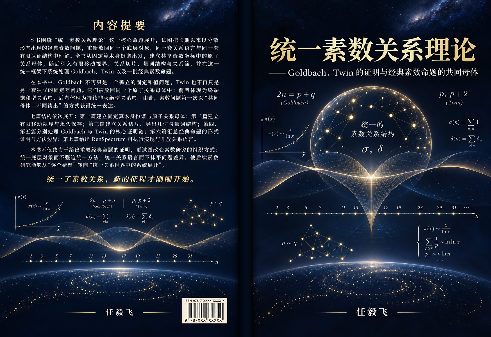

# 统一素数关系理论

> Goldbach、Twin 的证明与经典素数命题的共同母体

**作者**：任毅飞 · 独立研究者

---

## 图书介绍与内容摘要

《统一素数关系理论》试图改变素数问题长期以来“一个猜想、一套语言”的组织方式。全书从整数的固定算术身份出发，建立原子生成、关系出生、有限移动视界、关系保真、和—差坐标、关系切片、量词分类与有限证书体系，把历史上彼此分散的素数问题重新放回同一个关系母体。

在这一体系中，哥德巴赫猜想与孪生素数猜想不再被看成两个完全孤立的问题。哥德巴赫猜想被识别为同一二原子关系场中的固定和值全称纤维，书中以“终端饱和型关系筛”完成其全称闭合；孪生素数猜想则被识别为单位固定差上的无限回归问题，通过连续平方移动视界、关系供给、有限吸收与跨视界累计，被组织为“持续非灭绝型关系筛”。

全书进一步把 prime tuples、Green–Tao、窗口型问题、多项式轨道、素数间隔、完整素因子关系及一批经典数论命题编译为统一的“关系轨道—身份条件—观察区域—整体量词”标准形。

统一并不意味着抹平差异。本书坚持“统一对象层，不强迫统一具体工具”：圆法、筛法、解析方法、有限素性证书等仍保留自己的信息层级。

全书七篇、485 章，最终以 RenSpectrum 工作台把理论推进到形式关系语言和可执行复核层。

它试图建立的，不只是两个经典猜想的证明，而是一门研究**关系类型及其证书**的统一素数关系理论。

## 关键词

**核心关键词：**

统一素数关系理论；固定算术身份谱；素数原子；原子关系母体；关系出生；有限移动视界；关系保真；永久关系；和—差坐标；关系切片；关系量词；有限证书；哥德巴赫猜想；孪生素数猜想；终端饱和；持续非灭绝；CRT 生存树；真实死亡；关系筛；prime tuples；Green–Tao；经典素数问题；形式证明；RenSpectrum；任谱；RPRS；关系编译；可执行验证

**宣传关键词：**

**一个框架处理一族问题；批量证明而非批量计算；统一关系语言；哥德巴赫猜想；孪生素数猜想；有限认证无限；数学理论到可执行复核。**

**强烈推荐互动课堂：** [https://qiaoranjushi.github.io/ghtmath](https://qiaoranjushi.github.io/ghtmath)

**作者：任毅飞（Yifei Ren）｜独立研究者**

## 全书目录

- 作者说明
- 前言：从素数的孤立谜题到统一关系世界
- **第一篇　固定算术身份谱与原子关系母体**
  - 第一章　第一对象：固定算术身份谱
  - 第二章　身份与关系：不能交换的两个层级
  - 第三章　为什么还需要原子坐标
  - 第四章　共享坐标上的两种基本运算
  - 第五章　乘法压缩：奇数乘法的精确搬运
  - 第六章　加法展开：二奇数关系的同坐标表达
  - 第七章　不可约原子：奇素数从乘法内部显现
  - 第八章　唯一原子分解与乘法履历
  - 第九章　原子射线：乘法生成的线性化
  - 第十章　非原子覆盖与下一原子的递归生成
  - 第十一章　从原子点到关系对象
  - 第十二章　关系出生律：一个新原子产生一整行
  - 第十三章　射线—关系对偶：同一个原子的双重展开
  - 第十四章　组合放大与区块接缝
  - 第十五章　持久嵌入：历史关系为什么不丢失
  - 第十六章　关系行平移：历史不是随机重采样
  - 第十七章　无损和—差坐标
  - 第十八章　从“关系实例”到“关系切片”
  - 第十九章　从二原子切片推广到一般位置映射
  - 第二十章　窗口、相邻素数与完整因子身份也是切片
  - 第二十一章　统一关系规范形
  - 第二十二章　关系保真：为什么不能过早压成一个数字
  - 第二十三章　高阶关系的自然入口
  - 第二十四章　有限层母体的正式定义
  - 第二十五章　母体动力学的零阶闭合
  - 第二十六章　一个完整的小例子
  - 第二十七章　第一篇基础定理总表
  - 第二十八章　从关系切片到量词结构
  - 第二十九章　关系母体的阅读方式
- **第二篇　有限移动视界、关系还原与永久保存**
  - 第一章　固定身份为什么不能代替关系
  - 第二章　关系还原：什么叫真正保存一个关系
  - 第三章　持久关系过滤：旧关系为什么永远不会丢失
  - 第四章　候选关系与确认关系
  - 第五章　关系保真状态：为什么一个计数通常不够
  - 第六章　统一移动视界：有限窗口如何获得零误差原子认证
  - 第七章　素数平方：移动视界的天然离散边界
  - 第八章　真实死亡层：一个合数只第一次死亡一次
  - 第九章　关系保真筛：从端点死亡到关系死亡
  - 第十章　有限关系的终端认证
  - 第十一章　从候选壳晋升到永久关系骨架
  - 第十二章　关系履历：对象不仅有结果，还有生成历史
  - 第十三章　出生与死亡存在严格时间错位
  - 第十四章　移动视界不是创造关系，而是终端读取关系
  - 第十五章　统一视界与读出适配视界
  - 第十六章　关系还原的统一规范形
  - 第十七章　有限视界如何进入无限量词
  - 第十八章　有限—无限入口定理
  - 第十九章　不同全称量词如何进入同一个母体
  - 第二十章　批量论证的有限基础
  - 第二十一章　有限闭合的四种基本形式
  - 第二十二章　四个基本例子
  - 第二十三章　统一动力学：出生、消解、晋升、持久、读出
  - 第二十四章　本篇基础定理总表
  - 第二十五章　关系层不能被固定谱抹去
  - 第二十六章　有限层与全局命题之间的纪律
  - 第二十七章　关系保真筛的通用技术接口
  - 第二十八章　从有限终端到统一关系理论
- **第三篇　关系切片、导出几何、量词结构与批量论证**
  - 第一章　二原子关系平面：和值与差值的共同母体
  - 第二章　关系平面的三个天然方向
  - 第三章　壳层交叉、正交生成与反射—平移
  - 第四章　低阶见证纪律：统一不能以丢失关系为代价
  - 第五章　有限 Goldbach 见证场
  - 第六章　Twin 是固定和值见证的相邻列持续
  - 第七章　固定差计数与见证持续的精确恒等式
  - 第八章　多列持续与一般 prime constellations
  - 第九章　时间方向与空间方向
  - 第十章　一般关系切片的定义
  - 第十一章　统一关系规范形
  - 第十二章　固定和、固定差与连续固定差
  - 第十三章　加权反射与仿射关系
  - 第十四章　有限模板与 prime tuples
  - 第十五章　Green–Tao 等差原子链
  - 第十六章　等差链由同差二原子关系连续拼接
  - 第十七章　三端链与固定和值镜像
  - 第十八章　任意长度等差链的固定和值镜像折叠
  - 第十九章　等差链的平方视界
  - 第二十章　等差链的单素数禁止类
  - 第二十一章　有限 CRT 层的链容量
  - 第二十二章　长链的内禀步长容量
  - 第二十三章　有限层非空模型
  - 第二十四章　高阶组织出生律
  - 第二十五章　Green–Tao 定理在统一关系语言中的表达
  - 第二十六章　等差链向 Goldbach 高重数的严格输送
  - 第二十七章　一个五项等差链例子
  - 第二十八章　窗口关系
  - 第二十九章　相邻素数指标关系
  - 第三十章　指数与多项式拉回
  - 第三十一章　完整因子身份关系
  - 第三十二章　量词不是装饰：它决定命题的全局类型
  - 第三十三章　为什么“全称”与“无限”必须分开
  - 第三十四章　批量论证：一次证明覆盖整个参数族
  - 第三十五章　全称纤维的批量判定
  - 第三十六章　无限回归的批量判定
  - 第三十七章　四类基本闭合方式
  - 第三十八章　关系等价与关系不同
  - 第三十九章　关系语言的最小操作
  - 第四十章　从数学语法到可执行关系语言
  - 第四十一章　三个自定义关系例子
  - 第四十二章　关系类型与量词类型是两个独立坐标
  - 第四十三章　经典关系的统一表
  - 第四十四章　批量论证的最低完整条件
  - 第四十五章　高阶结构何时有价值
  - 第四十六章　本篇基础定理总表
- **第四篇　有限控制几何、局部阻塞与关系筛**
  - 第一章　从关系语言进入控制几何
  - 第二章　任意有限阶关系空间
  - 第三章　乘法深度张量
  - 第四章　顶点、边、面与浅乘法深度
  - 第五章　关系轨道
  - 第六章　原子顶点预像定理
  - 第七章　有限控制深度
  - 第八章　相位周期与有限控制周期
  - 第九章　局部阻塞的统一定义
  - 第十章　局部许可不等于整体占据
  - 第十一章　有限偏移模板的局部指纹
  - 第十二章　模板局部许可
  - 第十三章　一个被完全阻塞的模板
  - 第十四章　等差模板的局部容量
  - 第十五章　有限轮局部容量
  - 第十六章　从有限容量到 CRT 生存树
  - 第十七章　首次局部淘汰守恒
  - 第十八章　普通整除与真实死亡
  - 第十九章　关系 first-killer
  - 第二十章　关系字母表
  - 第二十一章　关系保真筛
  - 第二十二章　为什么“剩多少”不是充分状态
  - 第二十三章　固定和值是二点反射相关
  - 第二十四章　有限模信息不能决定反射配对
  - 第二十五章　关系筛与元素筛的分工
  - 第二十六章　Liouville 奇偶身份
  - 第二十七章　真实死亡的奇偶翻转
  - 第二十八章　奇偶双通道转移
  - 第二十九章　关系四通道
  - 第三十章　乘法深度上界
  - 第三十一章　奇通道立方根认证
  - 第三十二章　立方根认证与固定和值存在的层级区别
  - 第三十三章　\(X^{1/4}\) 层的 \(P_1/P_3\) 分解
  - 第三十四章　简单单调比例为什么不够
  - 第三十五章　从奇偶障碍到反射定位
  - 第三十六章　从一般关系筛进入固定和值
  - 第三十七章　母—子读出继承
  - 第三十八章　为什么固定和值是最低阶精确关系之一
  - 第三十九章　有限历史与固定和值支撑
  - 第四十章　关系行平移
  - 第四十一章　固定和值重数递推
  - 第四十二章　终端视界算子
  - 第四十三章　固定和值自然终端冻结
  - 第四十四章　自然终端段
  - 第四十五章　换回偶数轴：素数间隔决定终端段宽度
  - 第四十六章　缺口与第一缺口
  - 第四十七章　固定和值内部的互反运动
  - 第四十八章　有限关系证书
  - 第四十九章　位置层：原子与乘法占位的互补身份
  - 第五十章　有限视界中的暂未读出状态
  - 第五十一章　固定和值只是重新配对
  - 第五十二章　关系槽耗尽定理
  - 第五十三章　逐槽精准补位恒等式
  - 第五十四章　整体关系槽守恒
  - 第五十五章　双乘法占位的责任分解
  - 第五十六章　原子出生与独占乘法作用的时间错位
  - 第五十七章　具体关系槽：\(N=12\)
  - 第五十八章　具体关系槽：\(N=16,N=18,N=20,N=40\)
  - 第五十九章　Goldbach 的关系完备性与准确位置
  - 第六十章　终端三重等价
  - 第六十一章　读出—终端落位定理
  - 第六十二章　完整有限截面
  - 第六十三章　支撑与重数
  - 第六十四章　八个标准关系筛算子
  - 第六十五章　终端饱和型与持续非灭绝型
  - 第六十六章　固定和值与固定差为什么不能使用同一终端逻辑
  - 第六十七章　有限终端与全称闭合的层级分工
  - 第六十八章　简单基数容量不能替代反射定位
  - 第六十九章　关系保真筛的四个可复用接口
  - 第七十章　一个新的关系怎样进入有限控制几何
  - 第七十一章　本篇基础定理总表
- **第五篇　无限关系的精准架构**
  - 第一章　从有限终端进入无限结构
  - 第二章　七种主要全局接口
  - 第三章　无限回归的精确判据
  - 第四章　逐参数全称纤维的精确判据
  - 第五章　窗口全称、任意长度与参数无限
  - 第六章　逐索引全称与身份块分离
  - 第七章　量词决定证明接口
  - 第八章　有限控制层的精确周期
  - 第九章　有限周期不等于无限关系周期
  - 第十章　三类接缝
  - 第十一章　为什么固定差没有共同终端
  - 第十二章　单位差是最小持续关系
  - 第十三章　单位差母—子继承
  - 第十四章　连续素数平方视界
  - 第十五章　平方视界唯一归属
  - 第十六章　平方接缝闭合
  - 第十七章　旧双逃逸关系
  - 第十八章　单层净化
  - 第十九章　平方视界精确 Twin 公式
  - 第二十章　关系死亡留下三原子见证
  - 第二十一章　单余因子单死亡
  - 第二十二章　清洁区与吸收区
  - 第二十三章　有限吸收资源池
  - 第二十四章　死亡匹配与有限强制
  - 第二十五章　局部移动区间
  - 第二十六章　关系空间与资源空间的尺度分离
  - 第二十七章　吸收资源的线性上界
  - 第二十八章　资源半衰
  - 第二十九章　资源寿命
  - 第三十章　有限寿命与全局容量是两个层次
  - 第三十一章　从 Twin 推广到任意固定偏移模板
  - 第三十二章　模板平方视界
  - 第三十三章　关系供给 \(B_H\)
  - 第三十四章　真实关系 \(T_H\) 与死亡 \(D_H\)
  - 第三十五章　单层净化的一般形式
  - 第三十六章　统一吸收资源池
  - 第三十七章　wheel 与吸收复用度
  - 第三十八章　吸收容量定理
  - 第三十九章　资源池的纯结构上界
  - 第四十章　精确容量与结构容量
  - 第四十一章　净关系势
  - 第四十二章　两种有限关系证书
  - 第四十三章　吸收复用度的几个基本值
  - 第四十四章　Twin 是 \(\mu=1\) 的最小模型
  - 第四十五章　跨视界累计账本
  - 第四十六章　累计净势无限判据
  - 第四十七章　更强的逐窗证书
  - 第四十八章　“没有最后一个成功视界”的等价形式
  - 第四十九章　单资源寿命在累计架构中的准确位置
  - 第五十章　局部许可、有限净势与无限回归是三层不同结论
  - 第五十一章　Twin 的完整有限状态
  - 第五十二章　Twin 的全局命题怎样表达
  - 第五十三章　一般固定差
  - 第五十四章　一般 prime tuple
  - 第五十五章　Sophie Germain
  - 第五十六章　Mersenne
  - 第五十七章　Bunyakovsky 与 Schinzel H
  - 第五十八章　Green–Tao 的任意长度接口
  - 第五十九章　Goldbach、Legendre 与全称型接口
  - 第六十章　Brocard、Andrica、Firoozbakht 与 Grimm
  - 第六十一章　Erdős–Woods 与身份块分离
  - 第六十二章　批量证明不是批量计算
  - 第六十三章　无限回归的三种标准闭合
  - 第六十四章　全称型的三种标准闭合
  - 第六十五章　任意长度型的标准闭合
  - 第六十六章　参数无限型的标准闭合
  - 第六十七章　关系对象与证书对象应该一致
  - 第六十八章　一般 Twin 单关系证书
  - 第六十九章　足厚单主链证书
  - 第七十章　移动视界与关系证书是同一原则的两个尺度
  - 第七十一章　905 个连续平方视界
  - 第七十二章　结构净势的同一批有限数据
  - 第七十三章　历史资源复用的有限验收
  - 第七十四章　关系级证书的计算比较
  - 第七十五章　无限关系模块的参数含义
  - 第七十六章　量词模块的参数含义
  - 第七十七章　证书作为定理接口
  - 第七十八章　Twin 的形式证明与无限闭合
  - 第七十九章　一般经典命题怎样调用第五篇
  - 第八十章　无限量词定理
  - 第八十一章　持续型关系筛定理
  - 第八十二章　一般模板供给—吸收定理
  - 第八十三章　关系级证书定理
- **第六篇　经典命题的形式证明、关系切片全集与方法边界**
  - 第一章　关系母体先于具名问题
  - 第二章　统一母体的五个层级
  - 第三章　任意有限阶关系空间
  - 第四章　乘法深度张量与原子顶点骨架
  - 第五章　顶点、边、面与浅乘法深度
  - 第六章　关系轨道
  - 第七章　原子顶点预像定理
  - 第八章　一个关系的统一四元表示
  - 第九章　有限关系终端认证
  - 第十章　有限世界怎样组成全局关系
  - 第十一章　固定关系切片
  - 第十二章　高阶仿射关系
  - 第十三章　非线性关系轨道
  - 第十四章　稀疏指数关系轨道
  - 第十五章　区间与度量关系
  - 第十六章　统计与谱关系
  - 第十七章　Goldbach：固定和值的全称纤维
  - 第十八章　Lemoine / Lévy：加权反射纤维
  - 第十九章　弱 Goldbach：关系阶数升为三元
  - 第二十章　Chen：关系几何不变，目标深度放宽
  - 第二十一章　Twin：单位固定差的无限回归
  - 第二十二章　Polignac：整个固定差族
  - 第二十三章　Sophie Germain 与 safe prime：斜线关系
  - 第二十四章　Hardy–Littlewood prime \(k\)-tuple
  - 第二十五章　Green–Tao：任意长等差关系
  - 第二十六章　Green–Tao 向固定和值的镜像折叠
  - 第二十七章　Dirichlet：同余子格上的无限占据
  - 第二十八章　PNT 与 PNT in AP：coarse density
  - 第二十九章　Bertrand：移动区间占据
  - 第三十章　Legendre：整数平方窗口
  - 第三十一章　Oppermann：双窗口全称
  - 第三十二章　Brocard：连续素数平方窗口计数
  - 第三十三章　Andrica：prime-gap 度量关系
  - 第三十四章　Firoozbakht：相邻素数的归一化增长
  - 第三十五章　\(n^2+1\)：二次轨道
  - 第三十六章　Bunyakovsky：一般多项式轨道
  - 第三十七章　Schinzel H：多项式束
  - 第三十八章　Mersenne：指数稀疏轨道
  - 第三十九章　Fermat：双指数稀疏轨道
  - 第四十章　Waring–Goldbach：非线性固定和流形
  - 第四十一章　Grimm：完整因子集合与匹配
  - 第四十二章　Erdős–Woods：身份块分离
  - 第四十三章　Landau 四题的四种不同读法
  - 第四十四章　RH / GRH：全局谱接口
  - 第四十五章　关系之间的结构映射
  - 第四十六章　无损高阶—低阶传递
  - 第四十七章　固定和值见证场向 prime constellations 的反向读取
  - 第四十八章　高阶存在不等于低阶全称
  - 第四十九章　低阶关系为什么最少冗余
  - 第五十章　低阶命题拒绝的四种放宽
  - 第五十一章　结构可以升阶，见证不能丢失
  - 第五十二章　埃拉托斯特尼筛：乘法占位
  - 第五十三章　Brun 筛：多端 rough relation
  - 第五十四章　Selberg 筛：优化局部排除，不增加缺失身份
  - 第五十五章　组合筛与线性筛：浅乘法深度
  - 第五十六章　大筛：多模平均控制
  - 第五十七章　Bombieri–Vinogradov：平均模分布
  - 第五十八章　Hardy–Littlewood 圆法：固定和的频率读出
  - 第五十九章　为什么三元与高阶加法更有平滑
  - 第六十章　Chen：放宽深度而保持关系
  - 第六十一章　GPY 与 Maynard–Tao：差值进入有限带
  - 第六十二章　Green–Tao：高阶组合结构
  - 第六十三章　解析 \(L\)-函数：全局谱
  - 第六十四章　Pocklington、Lucas、APR、ECPP：有限证书
  - 第六十五章　有限循环群上的 coarse 空间
  - 第六十六章　Fourier 支撑严格分离
  - 第六十七章　卷积严格解耦
  - 第六十八章　Primorial 壳层
  - 第六十九章　强制筛方向与横向创新
  - 第七十章　coarse energy 递推
  - 第七十一章　局部因子传输
  - 第七十二章　有限 Duhamel 公式
  - 第七十三章　乘法深度 parity
  - 第七十四章　rough survivor 与 signed survivor
  - 第七十五章　固定和值的 parity-resolved 分解
  - 第七十六章　parity saturation 的吸收性质
  - 第七十七章　第一次灭绝与关系图顶点覆盖
  - 第七十八章　ordinary death 与 true death
  - 第七十九章　Child-mode anisotropy
  - 第八十章　Goldbach 与固定差的解析对偶
  - 第八十一章　平均控制与 all-target 的距离
  - 第八十二章　pure positive energy 的信息边界
  - 第八十三章　单尺度 reflection gap 的边界
  - 第八十四章　moving-target determinant 结构
  - 第八十五章　RWF-II 作为解析接口
  - 第八十六章　方法与信息层级
  - 第八十七章　高阶方法何时能进入低阶命题
  - 第八十八章　almost-all 与 all-target
  - 第八十九章　bounded band 与 fixed fiber
  - 第九十章　almost-prime 与 prime-depth
  - 第九十一章　高阶平滑与低阶刚性
  - 第九十二章　关系困难如何比较
  - 第九十三章　原子层复杂度
  - 第九十四章　视界复杂度
  - 第九十五章　关系复杂度
  - 第九十六章　证书复杂度
  - 第九十七章　关系位置总表
  - 第九十八章　Landau 四题总表
  - 第九十九章　一个新关系进入母体的标准步骤
  - 第一百章　统一对象层，不统一具体工具
- **第七篇　RenSpectrum：理论的可执行实现与开放关系语言**
  - 第一章　RenSpectrum：名称的完整含义
  - 第二章　视觉标识也是关系语言的一部分
  - 第三章　软件不是证明来源，而是证明语义的执行环境
  - 第四章　RenSpectrum 的七个执行层
  - 第五章　快速读取的统一编译式
  - 第六章　anchor：关系实例的自由位置
  - 第七章　快速读取的输入字段
  - 第八章　逐项关系谱
  - 第九章　固定和与加权反射
  - 第十章　固定差与连续固定差
  - 第十一章　仿射关系
  - 第十二章　固定偏移模板与阻塞样例
  - 第十三章　Green–Tao 固定切片
  - 第十四章　窗口关系
  - 第十五章　相邻素数指标
  - 第十六章　指数与多项式拉回
  - 第十七章　完整因子身份关系
  - 第十八章　三类混合关系示例
  - 第十九章　软件首先识别量词类型
  - 第二十章　INF_RECURRENCE
  - 第二十一章　UNIVERSAL_FIBER
  - 第二十二章　WINDOW_UNIVERSAL
  - 第二十三章　UNIVERSAL_PREDICATE
  - 第二十四章　ARBITRARILY_LONG
  - 第二十五章　PARAMETER_INFINITE
  - 第二十六章　BLOCK_SEPARATION
  - 第二十七章　三类接缝的可执行定义
  - 第二十八章　有限循环 \(S_0\) 与全局持续 \(S_\infty\)
  - 第二十九章　平方接缝闭合扫描
  - 第三十章　平方窗口持续读数
  - 第三十一章　模板 \(H\) 的规范化
  - 第三十二章　局部阻塞指纹
  - 第三十三章　模板 admissible 状态
  - 第三十四章　\(B_H\)：关系吐出
  - 第三十五章　\(U\)：吸收资源
  - 第三十六章　\(Q\) 与 \(\mu_H(Q)\)
  - 第三十七章　两种吸收容量
  - 第三十八章　两种净关系势
  - 第三十九章　\(T_H\) 与 \(D_H\)
  - 第四十章　哪些关系自动进入 balance 模块
  - 第四十一章　RSL 的名称与目的
  - 第四十二章　RSL 的母子纪律
  - 第四十三章　RSL 的基本结构
  - 第四十四章　anchor 字段
  - 第四十五章　parameters 字段
  - 第四十六章　maps
  - 第四十七章　map_generator
  - 第四十八章　predicate
  - 第四十九章　quantifier
  - 第五十章　Twin 的 RSL 表达
  - 第五十一章　Goldbach 的 RSL 表达
  - 第五十二章　Polignac 的 RSL 表达
  - 第五十三章　Green–Tao 固定切片的 RSL 表达
  - 第五十四章　混合多项式关系
  - 第五十五章　RSL 编译管线
  - 第五十六章　RSL 的开放原则
  - 第五十七章　为什么必须先做计算预算
  - 第五十八章　Web 稠密谱的内存模型
  - 第五十九章　四级任务风险
  - 第六十章　Web 工程阈值
  - 第六十一章　自适应设备内存档位
  - 第六十二章　CPU 线程与浏览器能力探测
  - 第六十三章　JavaScript 整数边界
  - 第六十四章　Mersenne 与 BigInt
  - 第六十五章　高坐标不等于大内存
  - 第六十六章　segmented sieve
  - 第六十七章　Web Worker
  - 第六十八章　WebAssembly
  - 第六十九章　Wasm 多线程
  - 第七十章　WebGPU 的准确位置
  - 第七十一章　GPU 不应承担所有任务
  - 第七十二章　RenSpectrum Desktop
  - 第七十三章　四级执行后端
  - 第七十四章　关系类型与推荐后端
  - 第七十五章　合理的性能路线
  - 第七十六章　为什么需要验证等级
  - 第七十七章　\(\mathsf V_0\)：语法可执行
  - 第七十八章　\(\mathsf V_1\)：身份读取可复核
  - 第七十九章　\(\mathsf V_2\)：有限关系读取可复核
  - 第八十章　\(\mathsf V_3\)：有限终端证书
  - 第八十一章　\(\mathsf V_4\)：结构批量证书
  - 第八十二章　\(\mathsf V_5\)：全局量词闭合
  - 第八十三章　验证等级的基本纪律
  - 第八十四章　确定性优先
  - 第八十五章　每次运行的最小记录
  - 第八十六章　软件版本与关系版本必须同时保存
  - 第八十七章　有限输出的完整性检查
  - 第八十八章　阻塞样例是基础回归测试
  - 第八十九章　关系恒等式是交叉检查器
  - 第九十章　\(B_H=T_H+D_H\) 的账本检查
  - 第九十一章　BigInt 路径与 Number 路径的交叉区
  - 第九十二章　Web 与 Desktop 的语义一致性
  - 第九十三章　身份谱参数
  - 第九十四章　关系语言参数
  - 第九十五章　有限视界与接缝参数
  - 第九十六章　阻塞参数
  - 第九十七章　供给—吸收参数
  - 第九十八章　量词参数
  - 第九十九章　软件预算参数
  - 第一百章　RSL 字段词典
  - 第一百零一章　协议目标
  - 第一百零二章　协议 A：固定关系读取
  - 第一百零三章　协议 B：阻塞证书
  - 第一百零四章　协议 C：吐出—吸收证书
  - 第一百零五章　协议 D：累计无限接口
  - 第一百零六章　协议 E：BigInt 与大整数证书
  - 第一百零七章　协议 F：Web / Desktop 交叉复核
  - 第一百零八章　协议 G：版本归档
  - 第一百零九章　预置关系不是系统边界
  - 第一百一十章　从“证明问题”到“编译问题”
  - 第一百一十一章　统一的不是符号，而是信息流
  - 第一百一十二章　为什么问题会以这种形式出现
  - 第一百一十三章　开放不是无限增加按钮
  - 第一百一十四章　新的关系也可以反过来检查理论语言
  - 第一百一十五章　软件不会替读者思考
  - 第一百一十六章　一个开放工作台应当允许失败留下来
  - 第一百一十七章　从固定谱到开放知识生成
  - 第一百一十八章　从七篇重新看全书
  - 第一百一十九章　原子先于问题，关系先于命名
  - 第一百二十章　从“怎样证明”到“为什么问题会出现”
  - 第一百二十一章　经典方法不再彼此孤立
  - 第一百二十二章　统一母体不是知识档案馆
  - 第一百二十三章　开放的真正含义：共同入口与方法自由
  - 第一百二十四章　机器与人的分工
  - 第一百二十五章　一个读者怎样继续使用这本书
  - 第一百二十六章　从网页到开放实现
  - 第一百二十七章　全书最后的参数不再只是参数
  - 第一百二十八章　全书最后的结论
- 如何使用本书的参考文献
- 参考文献
- 后记：统一之后，新的征程开始
- 每一个素数都孤独，但没有一个素数真正孤立

---

**Subtitle: *Proofs of the Goldbach and Twin Prime Conjectures and the Common Matrix of Classical Prime Propositions***

---

### 相关链接

- 交互教学站：<https://ghtmath.pages.dev/prime-relations/>
- 全书 PDF：<prime-relations/books/统一素数关系理论_中文版_A4排版.pdf>
- 英文版：<Unified Prime Relations Theory.md>
- 返回项目首页：<https://github.com/qiaoranjushi/ghtmath>
